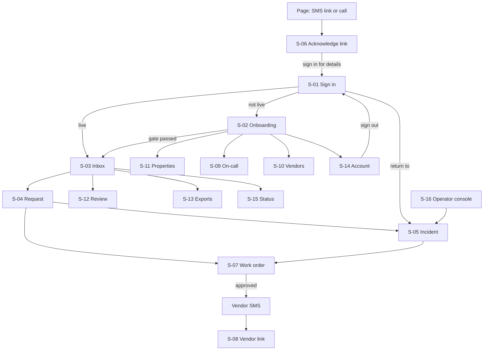

# App flow — FixTriage

Roles and rules: [PRD sections 5 and 7](PRD.md#7-product-rules-canonical-other-files-cite-these-ids). Routes and APIs: [TRD 5.1](TRD.md#51-api-contracts). Tables: [schema.md](schema.md). All behaviour is proposed; nothing is built.

## 1. Screen inventory

| ID | Route | Roles | Purpose | MH |
|---|---|---|---|---|
| S-01 | `/sign-in`, `/sign-in/totp`, `/reset` | Anyone | Sign in, second factor, reset | MH-14 |
| S-02 | `/onboarding` | `owner` | Checklist to the go-live gate | MH-01, MH-05 |
| S-03 | `/inbox` | `owner`, `manager` | All requests; needs-triage first | MH-04, MH-08 |
| S-04 | `/requests/:id` | `owner`, `manager` | Conversation, evidence, classification, correction, review mark | MH-03, MH-08, MH-13 |
| S-05 | `/incidents/:id` | `owner`, `manager` | Live escalation timeline, acknowledge, outcome, duplicates | MH-05, MH-06, MH-07 |
| S-06 | `/a/:token` | Holder of link | Acknowledge without signing in | MH-05 |
| S-07 | `/work-orders/:id` | `owner`, `manager` | Edit and approve dispatch; delivery and vendor status | MH-09, MH-10 |
| S-08 | `/v/:token` | Vendor with link | Confirm or decline | MH-10 |
| S-09 | `/settings/on-call` | `owner` (edit), `manager` (view) | Schedule, levels, test pages, coverage check | MH-05 |
| S-10 | `/settings/vendors` | `owner` (edit), `manager` (view) | Vendors by trade, order, import | MH-11 |
| S-11 | `/settings/properties` | `owner`, `manager` | Properties, units, tenant contacts, import | MH-01 |
| S-12 | `/review` | `owner`, `manager` | Morning "was this urgent?" list, review queue, pilot report | MH-13 |
| S-13 | `/exports` | `owner`, `manager` | Digest settings, CSV export jobs | MH-12 |
| S-14 | `/settings/account` | `owner` | Users, emergency contact, business hours, privacy requests, retention, deletion | MH-14, MH-15 |
| S-15 | `/status` | `owner`, `manager` | Channel state set by the monitor or operator, last real inbound message, last platform probe; source of the global banner | MH-16 |
| S-16 | `/ops`, `/ops/escalations`, `/ops/dead-letters` | `operator` | Level 4 queue, "engaged" and call log, relayed acknowledgement, dead letters, probe history | MH-05, MH-16 |

Any signed-in user without the role for a route sees the permission-denied state (section 4), never a redirect loop. A URL containing another account's ID returns "not found".

## 2. Navigation

## 3. Screens

Each block: story · entry · inputs · visible · actions → destination · acceptance checks (AC).

**S-01 Sign in.** Story: as staff I sign in with password and code. Entry: any protected URL redirects here with `return_to` (same-origin path only). Inputs: email, password, 6-digit code or recovery code. Visible: nothing about whether an email exists. Actions: sign in → `return_to` or S-03 (S-02 if not live); reset → email link, then TOTP or recovery code still required. AC: wrong code keeps the email field, focuses the code field and announces the error; five failures start a delay shown in text; sign-out ends the session server-side and Back shows S-01.

**S-02 Onboarding.** Story: as owner I reach go-live knowing nothing is missing. Entry: first sign-in or any time before go-live. Visible: checklist with state per item: units imported; emergency contact name and number (s.33(2)); business hours and holidays; on-call levels 1-3; test page acknowledged by each person; tenant contacts (optional); vendors (optional); named reviewer; channel test (send a text and an email, see them arrive); privacy schedule acknowledged; two operators on the Level 4 roster (shown read-only). Actions: open item → S-09, S-10, S-11, S-14; "Go live" enabled only when EP-9 holds. AC: optional items never block; each blocked item states why in words; leaving and returning keeps progress; go-live asks for confirmation showing the two channels and the first on-call name.

**S-03 Inbox.** Story: as manager I see what needs me first. Visible: sections in fixed order — Active incidents (unacknowledged and reopened first, with the reason: new, no outcome, dispatch failed, report from another unit), Needs triage (`uncertain` with countdown to page, and "cannot be texted — phone the tenant"), Unknown sender, Awaiting approval, Vendor not responding, Routine open, Closed. Per row: tier in words, property and unit, first line, age, report count, delivery warnings. Inputs: filters (tier, property, state, date) kept in the query string; search by unit or address. Actions: open row → S-04 or S-05. There are no batch actions on requests. AC: an incident row cannot be hidden by any filter while unacknowledged; new rows arrive without reload and are announced; empty state says "No requests yet" and shows the two channel addresses.

**S-04 Request.** Story: as manager I check what the system decided and fix it. Visible: full conversation with original text, original-language text beside any translation, photos, sender and matched unit; decision panel: final tier, rule hit (rule name and version) and model proposal shown separately, model confidence, follow-up questions asked and answers; delivery status of every message; audit trail. Inputs: trade, tier, unit; reason (required when lowering a tier); review mark. Actions: correct → stays; assign unit (HI-6); raise tier → creates incident → S-05; create or open work order → S-07; mark correct or incorrect (only the named reviewer's mark counts, HI-9; approving a work order never creates a mark); confirm or reject a suggested link to an incident. AC: lowering a tier without a reason is refused with the field identified; raising a tier starts paging and says so before confirming; a request from a tenant who sent `STOP` shows "cannot be texted — phone the tenant", the number to call, whether an email safety reply was sent, and a "I phoned them" control (FD-7, HI-12).

**S-05 Incident.** Story: as on-call I see who has been tried and take it. Visible: tier, property, units reported, report count with each report and its link state (suggested, confirmed) (DU-3), why the current escalation is running (new, no outcome, dispatch failed with the vendor's name and the pre-drafted next vendor, report from another unit), timeline of every page attempt with channel, delivery state and time across all escalations of the incident, "operator engaged" entries, next scheduled step with countdown, tenant messages sent, current owner. Actions: Acknowledge; Record outcome (vendor dispatched → S-07; handled by phone; attending; downgrade with reason); after a failed dispatch: "Review next vendor" → S-07 review step, or "I phoned them"; per suggested report: "Same problem" or "Separate problem"; "Mark building-wide" (with confirmation, DU-4d); Unmerge; Call tenant (tel link). AC: Acknowledge works once, a second click or a simultaneous keypress reports "already acknowledged by Dana at 02:16"; timeline updates live and is announced politely; after acknowledgement an outcome reminder shows the EP-7 deadline; downgrade requires a reason and is listed on S-12 the next morning; "Separate problem" creates a new incident that pages at once; "Mark building-wide" states that later reports of this hazard at this address will not page for 6 hours and names who set it.

**S-06 Acknowledge link.** Story: as on-call woken at 2 am I acknowledge in one tap. Entry: token from the page SMS. Visible: street address, hazard class, tier, time received, report count. Not visible: tenant name, number, message text. Actions: one button "I have this" (POST) → confirmation with "Sign in for details" → S-01 → S-05. AC: the acknowledgement is recorded as the person the link was sent to; expired or used token says so and gives the office number; GET never acknowledges (link previewers cannot acknowledge); after the tap, focus moves to the confirmation heading and the result is announced; works at 320 px width; no session is created.

**S-07 Work order.** Story: as manager I send the right vendor the right text. Visible: unit, trade, tier, summary, photos chosen for the vendor, draft message, proposed vendor with preferred order, access notes, state banner (Draft, Approved, Sent, Delivered, Confirmed, Declined, No response, Undelivered). Inputs: every field editable while Draft. Actions: Approve and send → review step showing recipient name, number and exact text → Sent; after failure: "Send to next vendor" (pre-filled, same review step) or "I phoned them" with note; Close. AC: nothing is sent before the review step is confirmed (FD-1); a trade with no vendor shows "No vendor on file" with a free-text recipient option and never blocks saving; the text confirmed equals the text sent (hash check), otherwise the send is refused and the draft is reloaded; double click sends once.

**S-08 Vendor link.** Story: as vendor I confirm from my phone. Visible: what the approver approved: address, unit, issue, access notes, photos, who to call. Actions: Confirm (with optional arrival time) or Decline (with optional reason). AC: reply `YES` or `NO` by SMS has the same effect; a second response after confirmation shows the recorded answer; expired link gives the office number.

**S-09 On-call.** Story: as owner I decide who owns each hour. Visible: week grid by level; coverage bar for the next 14 days; last test-page result per person; acknowledgement timeout (3-10 minutes, default 5). Inputs: person, level, recurring shift, date overrides. Actions: Save; Send test page. AC: saving a gap is refused and the gap is named ("Saturday 00:00-08:00 has no Level 1"); fewer than two different people is refused; every change is audited and emailed to the `owner`; a failed test page raises the global banner.

**S-10 Vendors.** Inputs: name, trades, mobile, email, after-hours flag, order per trade (changed with "move up" and "move down" buttons, no dragging); CSV import. AC: import shows per-row results (added, updated, rejected with reason) and can be re-run without duplicates (match on mobile within the account); invalid phone formats are rejected with an example.

**S-11 Properties.** Inputs: property address, unit label, optional tenant name, mobile, email; optional per-property emergency contact and gas utility number; CSV import. AC: same import behaviour as S-10; a tenant contact can be deleted or exported (MH-15); two units may share a phone number, in which case messages from it go to Unknown sender for a human to assign.

**S-12 Review.** Visible: (a) every after-hours `routine` request and every report attached without a page (DU-4d) from the last night with "Was this urgent?" Yes/No; (b) review queue of unmarked requests; (c) report: SM-01, SM-03 with numerator, denominator and the count of `uncertain` requests inside the denominator, SM-04, list of corrections with corrected values, downgrades with reasons. Actions: mark one request at a time (reviewer only; others see the queue read-only); export report. AC: "Yes" on list (a) records a missed urgent case, raises the tier and alerts the operator; the accuracy figure shows its denominator and the minimum of 20; the export matches the on-screen numbers.

**S-13 Exports.** Inputs: date range, state, format (generic CSV; column sets for Buildium and DoorLoop are a proposal pending sample import files). Actions: create export → job row with state; download via short-lived link. AC: an export of zero rows completes with a message; a failed job offers retry and never a partial file.

**S-14 Account.** Inputs: users and roles; emergency contact; business hours and holidays; privacy request log (requester, type, received date, due date 30 days later, outcome); retention settings within bounds; account deletion request. AC: disabling a user ends their sessions and is refused if it would break EP-9; changing email, phone or TOTP requires the password and a code again.

**S-15 Status.** Visible: each channel with its last real inbound message, the last platform probe result, paging path state (last weekly test pages), open provider incidents entered by the operator or the monitor. AC: when the external monitor or an operator marks intake impaired, every staff screen shows a banner "Text intake may be delayed — tenants can still phone 604-555-0100" with the account's emergency number.

**S-16 Operator console.** Visible: escalations at Level 4 across accounts with the chain's phone numbers, "I am on it" (operator engaged), a call-attempt log form, "Accepted by phone" with the account person selected (relayed acknowledgement), dead-lettered inbound and outbound messages with replay, probe and monitor history. AC: "I am on it" never stops paging of Levels 1-3 and says so; "Accepted by phone" requires choosing a person of that account and ends the escalation in that person's name; opening an account's incident requires a reason and writes an audit event visible to that account's `owner`; replay never sends a second vendor dispatch.

## 4. States

| State | Where | Behaviour |
|---|---|---|
| Empty | S-03, S-10, S-11, S-12, S-13 | Says what is missing and the next action |
| Loading | All | Skeleton within 200 ms; previous data stays visible on refresh |
| Processing | S-04 (classifying), S-07 (sending), S-13 (export), imports | Named step and elapsed time; safe to leave; state is stored server-side |
| Partial success | Imports; incident with one page channel failed; work order sent by SMS but email bounced | Per-item result list; failures first; succeeded items are never re-sent on retry |
| Validation error | All forms | Summary at top with links to fields; focus moves to the summary; fields keep their values |
| Permission denied | Role mismatch | "Your role cannot open this. Ask the account owner." No data shown |
| Timeout | Any mutation | "We could not confirm this was saved." Shows the stored state after an automatic re-read; never asks the user to guess |
| Retry | Send, export, import | Uses the same idempotency key; shows "already done" when the first attempt succeeded |
| Stale | S-05, S-07 | "Dana changed this 20 seconds ago" with reload; the user's unsent edits are kept |
| Session expired | Any | Sign in again → same URL; an unsent draft is restored from local storage for that URL (no personal data beyond the draft text, cleared after restore) |

## 5. Refresh, Back, Forward, deep links, duplicates, batches

- Every screen is addressable; filters, tabs and pagination are in the URL; refresh reproduces the view (R-18). Timelines and countdowns are computed from server timestamps, so refresh never resets a countdown.
- Back from S-07 to S-04 to S-03 restores scroll position and filters. Back after "Approve and send" shows the Sent state, never the Draft form.
- Deep links from pages, digests and emails go through S-01 and return to the target. Links are built from the public base URL (R-16).
- Duplicate submission: all mutating buttons disable on first activation and carry an idempotency key; acknowledging, approving, merging and marking are safe to repeat.
- Batch actions exist only for imports. Each batch reports per-row results and can be retried without repeating successes (R-19). There is no batch review mark, batch downgrade, batch dispatch or batch acknowledge.
- Reopening unfinished work: drafts of work orders, half-finished onboarding and unrecorded outcomes are stored server-side and listed at the top of S-03 for the user who started them.

## 6. What the user reviews before an external or irreversible action

| Action | Reviewed first |
|---|---|
| Send vendor dispatch (external, cannot be recalled) | Recipient name and number, full text, attached photos, whether after hours |
| Go live | Channels, emergency contact, first on-call person, test-page results |
| Downgrade a tier | Original messages, rule hit, required reason; statement that paging will stop |
| Confirm "same problem" | Both reports side by side; statement that one work order will remain; undo available |
| Mark building-wide | Units reported so far; statement that further reports of this hazard at this address will not page for 6 hours and will be listed next morning |
| Delete tenant data or account | What is deleted, what stays in backups and until when (schema.md section 8) |
| Raise a tier | Statement that the on-call chain will be paged now |

## 7. End-to-end paths

| Path | Steps |
|---|---|
| Onboarding | S-01 → S-02 → S-11 → S-14 → S-09 (test pages) → S-10 → S-02 go-live → S-03 |
| Primary, routine | Tenant message → S-03 → S-04 → S-07 approve → vendor S-08 → S-03 closed → S-13 export |
| Primary, urgent after hours | Tenant message → page → S-06 → S-01 → S-05 outcome → S-07 approve → S-08 |
| After hours, not paged at once (PRD EP-10a) | Tenant message with no rule or candidate floor → fixed auto-reply with "If this is an emergency (flood, no heat, gas, fire, no power, locked out), reply URGENT" (the after-hours safety reply, or the separate `tenant.urgent_prompt` inside the 30-minute window); no screen. Tenant replies `URGENT` (any case, common misspellings, `EMERGENCY`) → request raised to `urgent` by rule `ur.tenant_urgent` → page → S-06 → S-05, as the urgent path. No reply → the request stays as decided and appears in the next-morning list (MH-13). An opted-out sender (`STOP`) gets no prompt by SMS and is paged as cannot-text (S-04 "phone the tenant"). If the message carrying the URGENT line cannot be delivered, the request becomes `uncertain`, cannot-text, and pages at once (S-03 needs triage, S-05) (PRD EP-10a(b)). |
| Tenant sends only `HELP` (or `HELP!`, `INFO`, `help me`) (PRD FD-7a) | Provider may send its HELP text; FixTriage still sends the safety reply and opens an `uncertain` request → after hours page → S-06 → S-05; business hours S-03 needs triage with the 15-minute countdown. Only `STOP` creates no request |
| Review and correction | S-12 list (a) → S-04 correct → S-12 report |
| Recovery, failed dispatch | Routine: S-07 "Undelivered" → next vendor review step → Sent, or "I phoned them". Emergency: page (reopened escalation) → S-06 or S-05 acknowledge → S-07 next vendor review step, or "I phoned them" |
| Sign-out | S-14 or header menu → S-01 |
