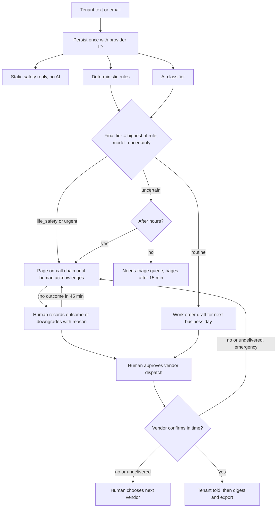

# PRD — FixTriage

Labels and IDs follow the legend in [Decision.md section 0](Decision.md#0-how-numbers-are-labelled-used-in-all-ten-files). Every threshold in this file is `[P]` unless labelled otherwise. "Account" = paying brokerage; "tenant" = renter.

## 1. Overview

FixTriage sits between tenants and a small BC rental property manager. Tenants keep texting and emailing. FixTriage answers every first message with a fixed safety reply, decides urgency with deterministic rules backed by an AI classifier, pages a named on-call person for urgent cases until a human acknowledges, and turns the rest into work orders with a drafted vendor message that a human approves `[C: offer]`.

The pilot answers one question: **can a small property manager improve after-hours handling without missing urgent cases?**

**Highest-consequence failure (named identically in CLAUDE.md and the verification file): HCF — an after-hours urgent case is missed or delayed.** Urgent case means no heat, flood, gas smell, fire or an after-hours lockout, and anything else in tiers `life_safety` or `urgent` below. Every after-hours lockout is treated as urgent so that a vulnerable tenant is never missed; nobody is asked to judge vulnerability (UR-7).

## 2. Why now

Heating season has started in BC; a failed primary heating system is an emergency repair under the Residential Tenancy Act `[S: SRC-01, s.33(1)(c)(iii)]`. Suite vendors are adding maintenance agents (Decision.md section 4), so the window for a standalone layer may be short `[A]`.

## 3. Goals

| ID | Goal | Measured by |
|---|---|---|
| G-1 | No urgent case is missed or delayed after hours | SM-01, SM-02 |
| G-2 | Classification good enough that the buyer keeps the pilot fee | SM-03 |
| G-3 | Fewer unnecessary after-hours interruptions than today | SM-04 |
| G-4 | A paid pilot converts to a recurring plan | SM-06 |

## 4. Problem statement

A 20-150 door firm with 1-8 staff `[C]` has no coordinator. After 5 pm the owner's phone is the system. A text saying "water coming through ceiling" and one saying "tap drips" arrive the same way; a missed one becomes property damage, a tenant self-arranging repairs at the landlord's cost `[S: SRC-01, s.33(3)-(5)]`, or an owner complaint `[C: buying trigger]`. Nothing here has been confirmed with a customer.

## 5. Buyer, users and roles

| Role | Who | Can do |
|---|---|---|
| `owner` | Managing broker; buyer; signs and pays | Everything in the account, including users, on-call policy, privacy and billing contact |
| `manager` | Property manager or administrator | Inbox, corrections, acknowledgement, downgrade, dispatch approval, review marks |
| On-call | Any `owner` or `manager` placed on the schedule | Receives pages; acknowledges by phone keypress, link or app |
| Reviewer | One `owner` or `manager` named in the pilot agreement and flagged in the account | The only user whose marks count toward SM-03 |
| Tenant | Renter | Texts or emails; receives replies; no login |
| Vendor | Trade contractor | Receives dispatch; confirms or declines by reply or link; no login |
| `operator` | FixTriage staff, at least two named people (primary and backup) before the first live account | Level 4 of every escalation chain; channel health; audited support access. Not a user of any account |

## 6. Workflows

**Current `[C]`:** message reaches a shared inbox or the owner's phone → someone reads it when they can → asks follow-up questions → decides urgency → looks up a vendor in a spreadsheet → texts the vendor → re-keys the job.

**Proposed:**

## 7. Product rules (canonical; other files cite these IDs)

### 7.1 Urgency tiers (UR)

| ID | Tier | Meaning | Deterministic triggers (rule set v1, lexicon in English plus the languages pilot buyers name) |
|---|---|---|---|
| UR-1 | `life_safety` | Danger to a person | Fire, smoke, burning smell, sparks; gas or rotten-egg smell; carbon monoxide alarm; water reaching electrical fittings; anyone injured or trapped |
| UR-2 | `urgent` | Emergency repair classes in s.33(1)(c) `[S: SRC-01]` and after-hours access loss | Major leak in pipes or roof, flooding; blocked or damaged water or sewer pipes or plumbing fixtures (sewage backup, no water, only toilet unusable); no heat or primary heating failure; damaged or defective lock giving access to a unit; electrical system failure; any lockout received after hours; tenant replies `URGENT` |
| UR-3 | `uncertain` | The system cannot establish a tier | Model error or timeout; model confidence below threshold (0.80 `[P]`, proposed in B1 because no number was set; owner to confirm with the Phase 0 labelled set); no usable text (photo only, empty, unreadable, language outside the lexicon); rule and model disagree by more than one tier |
| UR-4 | `routine` | Everything else | — |

- UR-5: final tier = highest of rule tier, model tier and `uncertain`, in the order `life_safety` > `urgent` > `uncertain` > `routine`. The model can raise a tier; it can never lower a rule result.
- UR-6: only a signed-in `owner` or `manager` can lower a tier, with a reason; the change is audited. A tenant message such as "never mind" does not lower it.
- UR-7: every after-hours lockout is `urgent`. The product never asks staff or AI to judge whether a tenant is vulnerable.
- UR-8: season, time of day and tenant history never lower a tier.

### 7.2 Escalation policy v1 (EP)

| ID | Rule |
|---|---|
| EP-1 | Every hour of every day has an owner: Level 1 on-call primary, Level 2 backup, Level 3 the account `owner`, Level 4 the FixTriage operators. Levels 1-3 must include at least two different people with different phone numbers. In a two-person firm the owner may hold Level 1 or 2 as well as Level 3, as long as the other person holds the remaining level. |
| EP-2 | A page is a voice call (spoken summary, "press 1 to acknowledge") and an SMS with an acknowledgement link, sent together. |
| EP-3 | Acknowledgement timeout 5 minutes per level, with a second attempt at 2 minutes. Level 1 at 0 and 2 min, Level 2 at 5 and 7, Level 3 at 10 and 12, Level 4 at 15. |
| EP-4 | If both channels to a level fail delivery, the next level is paged immediately. |
| EP-5 | Level 4: the primary operator is paged at 15 minutes and the backup operator at 20 if the primary has not responded; both are re-paged every 5 minutes until one responds. An operator response records "operator engaged" and **does not end the escalation or stop re-paging**: Levels 1-3 are re-paged every 15 minutes regardless. The operator phones Levels 1-3 and the account's emergency contact number by hand and logs each attempt. The escalation ends only when a person of the account acknowledges (keypress, link, app), or when the operator records that a named person of the account accepted the incident by phone; that entry stores the account person as acknowledger and the operator as relay. It is never closed by a timer. |
| EP-6 | At 15 minutes without acknowledgement the tenant receives a fixed message: still trying to reach the manager, call 911 if anyone is in danger, and the landlord's emergency contact number. |
| EP-7 | After acknowledgement the acknowledger must record an outcome (vendor dispatched, handled by phone, attending in person, or downgraded with reason) within 30 minutes; a reminder is sent at 30 minutes. |
| EP-8 | `uncertain` after hours follows EP-3 exactly as `urgent`. In business hours it enters the needs-triage queue and pages Level 1 if nobody triages it within 15 minutes. |
| EP-9 | Go-live gate: schedule covers 24 x 7 with no gap for the next 14 days; every scheduled person has acknowledged a test page on both channels; the emergency contact number is recorded; the account's channels pass a live inbound test; two operators are on the Level 4 roster. A schedule edit that creates a gap is rejected. |
| EP-10 | After-hours wording is chosen by the clock, never by the model: every after-hours message gets the after-hours variant of the safety reply (MH-02), which says the office is closed and how to raise the matter (`URGENT` or the emergency contact number). No tenant-facing text says a request "will be handled next business day" unless a human sent it. A model result of `routine` produces no message to the tenant. |
| EP-11 | An incident's escalation is **reopened** (a new escalation for the same incident, following EP-2..EP-6 from Level 1, with the previous acknowledger paged at the same time) when: (a) no outcome is recorded 45 minutes after acknowledgement (EP-7); (b) an emergency dispatch fails (FD-3); (c) a new report from a different unit is attached to an acknowledged incident (DU-4). It ends as in EP-5. |

### 7.3 Duplicate reports (DU)

| ID | Rule |
|---|---|
| DU-1 | Transport duplicate (same provider message ID): stored once; no second reply, page or work order. |
| DU-2 | Same sender, open request, within 30 minutes: appended to the same request; the tier is re-evaluated and can only rise. |
| DU-3 | Different senders, same property, same hazard class, within 6 hours: a new request linked to the open incident with link state `suggested`. Each reporter still gets the safety reply. The incident's report count is the number of linked requests in state `suggested` or `confirmed`, computed, not stored. |
| DU-4 | A suggestion never suppresses a page by itself. (a) Incident not yet acknowledged: the running chain continues and its pages show the new count and units; it is not restarted. (b) Incident acknowledged, new report from the **same unit**: no new page; it appears on the incident. (c) Incident acknowledged, new report from a **different unit, or a higher tier, or any `life_safety` report**: the escalation is reopened (EP-11c) until a human confirms it is the same problem. (d) A human may mark the incident "building-wide"; only then are later same-hazard reports from that property within 6 hours attached without a page, each still receiving the safety reply and listed for the next-morning review. |
| DU-5 | Confirming a merge is a human act and reversible; rejecting a suggestion makes the request its own incident with its own escalation. Reports are never deleted by a merge. One incident produces one work order and one vendor dispatch. |

### 7.4 Failed dispatch (FD)

| ID | Rule |
|---|---|
| FD-1 | No message reaches a vendor without a human approving that exact text and recipient `[C: human approves every dispatch]`. |
| FD-2 | Every outbound message has a tracked delivery status from the provider. |
| FD-3 | Emergency dispatch: the vendor must confirm (reply `YES` or the link) within 10 minutes. On provider status `undelivered` or `failed`, a decline, or timeout, the incident's escalation is reopened (EP-11b): the approver and Level 1 are paged with the next vendor in preferred order pre-drafted, then Level 2 at 5 minutes, Level 3 at 10, operators from 15, until a person acknowledges. That person approves the next vendor or records "phoned"; if neither is recorded within 30 minutes EP-11a applies. The system never contacts a second vendor on its own. |
| FD-4 | Routine dispatch: confirmation timeout 4 business hours, then "no vendor response" in the inbox and digest. |
| FD-5 | Message to a tenant undelivered: retry once, then email if known, then flag "tenant unreachable" to the manager. |
| FD-7 | Tenant who sent `STOP`: the provider blocks every later text to that number, safety texts included, until the tenant sends `START` `[S: SRC-21]`; CASL requires an unsubscribe to take effect without delay `[S: SRC-14, s.11(3)]`, and whether a safety text is exempt was not reviewed by counsel `[A]`. Safety path that remains: (a) the opt-out confirmation text, sent by the provider at the moment of `STOP`, carries the 911 line and the emergency contact number (configured wording, to be confirmed in T-1.1.4); (b) a later message from that tenant is still received and tiered; the safety reply goes by email if an address is known; (c) **any** later message from an opted-out sender, whatever its tier, is placed in needs-triage as "cannot be texted — phone the tenant" and after hours pages Level 1 under EP-8, because the tenant has received no instruction; (d) pages to staff are unaffected. |
| FD-6 | Paging provider or inbound channel unavailable: see MH-16. |

### 7.5 Points where a human must intervene (HI)

| ID | Point | Who |
|---|---|---|
| HI-1 | Set up units, emergency contact, on-call schedule, vendors; pass the go-live gate | `owner` |
| HI-2 | Acknowledge a page | On-call |
| HI-3 | Record the outcome of an acknowledged incident | Acknowledger |
| HI-4 | Lower a tier | `owner`, `manager` |
| HI-5 | Triage an `uncertain` request | `manager` or on-call |
| HI-6 | Assign a message from an unknown sender to a unit | `manager` |
| HI-7 | Approve every vendor dispatch; acknowledge a failed-dispatch page and choose the next vendor (FD-3) | `owner`, `manager` |
| HI-8 | Confirm or undo a duplicate merge | `owner`, `manager` |
| HI-9 | Mark each request correct or incorrect (pilot review) | Named reviewer |
| HI-10 | Phone the chain at Level 4; clear dead-lettered messages; respond to channel alerts | `operator` (primary, then backup) |
| HI-12 | Phone a tenant who cannot be texted (FD-7) | `manager` or on-call |
| HI-13 | Confirm that a report from another unit is the same problem, or mark an incident building-wide (DU-4) | Acknowledger, `owner`, `manager` |
| HI-11 | Answer tenant privacy requests (access, correction, deletion) | `owner`, assisted by `operator` |

## 8. Must-haves

Priority P0 = required before the first live account. After fix round 1 every must-have is P0: the pilot offer promises categorised work orders, a vendor draft, a digest and an export, and the refund test measures classification, so none of them can follow go-live.

| ID | P | User story | Observable acceptance criteria | Owner role |
|---|---|---|---|---|
| MH-01 | P0 | As a manager I give tenants one email address and one SMS number so requests arrive in one place | Each account has one of each `[C]`; every inbound message is stored exactly once with its provider ID before any other processing; attachments are stored with it | `owner` |
| MH-02 | P0 | As a tenant I am told at once what to do if I am in danger | A sender gets the fixed safety reply within 60 s (p99) for every inbound message unless one was sent to that sender in the previous 30 minutes; a message with a UR-1 or UR-2 rule hit always gets it again. Content: call 911 for fire, smoke or danger; for a gas smell go outside, then call the gas utility emergency line (default FortisBC 1-800-663-9911 `[S: SRC-13]`) or 911; the landlord's emergency contact number. After hours (by the clock) the variant in EP-10 is used. It is enqueued before and regardless of classification, with no AI in the path, also for duplicates from new senders. A separate second message carries the purpose notice (MH-15) and the opt-out line. Tenants who sent `STOP`: FD-7 | `operator` (template owner) |
| MH-03 | P0 | As a manager I trust that named hazards are never rated low | UR-1..UR-8 hold; the rule set is versioned and each decision stores the version and matched rule | `operator` |
| MH-04 | P0 | As a manager I am told when the system is not sure | UR-3 and EP-8 hold; forced model failure after hours results in a page, never in `routine` | `operator` |
| MH-05 | P0 | As an owner I know who owns each hour and that a page keeps going until a person answers | EP-1..EP-6, EP-9 hold; first page starts within 60 s (p95) of receipt for rule-triggered tiers | `owner` |
| MH-06 | P0 | As an owner I can see who took an incident and what they did | EP-7 holds; acknowledgement and outcome are recorded with person, channel and time | On-call |
| MH-07 | P0 | As an on-call person I get one page for one building problem, not twelve | DU-1..DU-5 hold | `manager` |
| MH-08 | P0 | As a manager I get trade, urgency and unit filled in, and the missing details asked for me | Classifier proposes trade, tier, unit and missing fields; follow-up questions come from a fixed bank per trade, at most 3, never for `life_safety`; 90% correct trade and urgency on the labelled set `[C: roadmap gate]` | `manager` |
| MH-09 | P0 | As a manager I approve a work order and vendor message in one step | Work order shows unit, trade, tier, photos, conversation and draft; FD-1 holds; edits before approval are kept | `manager` |
| MH-10 | P0 | As a manager I know when a vendor or tenant did not get the message | FD-2..FD-5 hold | `manager` |
| MH-11 | P0 | As an owner I keep my vendor list by trade in preferred order | CSV import and manual edit; at least one vendor per trade is optional, and a trade with none shows "no vendor on file" instead of blocking the work order | `owner` |
| MH-12 | P0 | As a manager I get a daily digest and a CSV I can import elsewhere | Digest at business-day start; CSV export of work orders `[C]`; each export is a retrievable job | `manager` |
| MH-13 | P0 | As a reviewer I mark each request and both sides see the same accuracy figure | The named reviewer marks each request correct or corrected (trade, tier, unit), one at a time; only these explicit marks count; SM-01, SM-03, SM-04 are computed from the log and exportable; every after-hours `routine` request and every report attached without a page (DU-4d) appears in a next-morning "was this urgent?" list | Reviewer |
| MH-14 | P0 | As an owner I know other firms cannot see my tenants | Account isolation enforced in the database for web, worker and files; roles as in section 5; password plus TOTP; every state change audited | `operator` |
| MH-15 | P0 | As an owner I can meet my privacy duties | Purpose notice in the second message of the first exchange `[S: SRC-03, s.10(1)]`; retention schedule applied automatically; per-tenant export and deletion; privacy request log with 30-day due date `[S: SRC-03, s.29]`; `STOP` honoured and shown | `owner` |
| MH-16 | P0 | As an owner I am told when the channel itself is down | (a) A monitor **outside** the application receives a check-in from `web` and from `worker` every 60 s and probes readiness every 60 s; it alerts both operators after 180 s of silence or a failed probe, so a dead worker, a stuck escalation timer or a stuck outbox is alerted within 5 minutes (60 + 180 + up to 60 s for the monitor's own cycle). (b) Provider-declared outages are alerted within 5 minutes of the provider's status change. (c) A platform-wide end-to-end probe (one text in, one out, on probe numbers, no account's number) runs every 6 hours; a silent provider-path failure can therefore go undetected for up to 6 hours 5 minutes, a stated gap. No paid message is sent per account. (d) Paging path: weekly test page per scheduled person (section 9). (f) **Not probed:** a fault that affects only one account's own number or address (misrouted number, broken forwarding at the brokerage). S-15 shows the time of the last real inbound message so staff can notice silence, but nothing alerts on it. (e) A voice call to the SMS number is forwarded to the account's emergency contact number, never dropped; the tenant-facing reply never calls the SMS number an emergency line | `operator` |

## 9. Highest-cost user mistake

**An on-call schedule that points at nobody: a stale phone number, a person on holiday, or a silenced phone.** Reviewer: the `owner`, through the go-live gate (EP-9) and a weekly test page to each scheduled person, whose result is shown on S-09 and in the digest. Correction: edit the schedule on S-09; a failed test page raises a banner for all staff and pages Level 3. Backstop: EP-3..EP-5 reach the operator within 15 minutes. Second mistake: acknowledging and going back to sleep; corrected by EP-7 and EP-11a. Third: lowering a real emergency; reviewed next morning in the SM-01 audit list with the reason shown.

## 10. Non-goals (MVP)

Autonomous vendor booking `[C]`; voice call or voicemail intake, although the brief's suggested stack lists "Twilio SMS and voice transcription" `[C]` (calls are forwarded, MH-16; GAP-11); a tenant or vendor app `[C]`; accounting, invoicing vendors, owner approvals; API integrations with Buildium or DoorLoop (CSV only `[C]`); advice to tenants beyond the fixed templates `[C: "do not give tenants safety advice beyond scripted guidance"]`; markets outside BC; WhatsApp; judging tenant vulnerability; replacing the s.33(2) emergency telephone contact.

## 11. Dependencies and constraints

| Item | Constraint |
|---|---|
| Messaging provider | Twilio `[C]`. Canadian domestic long codes need no registration on the page read; toll-free numbers need verification and unverified toll-free traffic to Canada is blocked; short codes take 12-16 weeks; carriers filter A2P traffic strictly `[S: SRC-09, SRC-11]`. Sender plan in TRD AD-08. |
| Email provider | Postmark inbound `[C]`; inbound processing is on the Pro plan and above `[S: SRC-18]`. |
| AI provider | Hosted low-cost model `[C]`; inference leaves Canada (GAP-08). |
| Law | RTA s.33 `[S: SRC-01]`; BC PIPA: the brokerage is responsible for personal information under its control even when not in its custody (s.4(2)), must protect it with reasonable security arrangements (s.34), must keep information used for a decision that directly affects an individual at least one year (s.35(1)) and destroy it when no longer needed (s.35(2)) `[S: SRC-03]`. Whether a triage decision is such a decision is not settled `[A]`; the retention schedule assumes it is. |
| Outbound messages | CASL content rules `[S: SRC-14]`; whether service messages to tenants are commercial electronic messages is not reviewed by counsel `[A]`. Every thread identifies the brokerage and honours `STOP`. |
| Buyer inputs | Required: unit list, emergency contact, at least two on-call people, business hours, a named reviewer. Tenant contact list and vendor list are optional; their absence creates manual steps (HI-6, free-text recipient on S-07), never a blocked request. |
| Team | 1-3 developers, founder in Vancouver `[C]`. |

## 12. Success metrics

Window for all: the 30 live pilot days per account unless stated. Source: application log exports (audit events, reviews). Baselines are unknown until discovery calls record them.

| ID | Kind | Metric and method | Denominator | Baseline | Target |
|---|---|---|---|---|---|
| SM-01 | Failure | Missed or delayed urgent cases: requests whose final reviewed tier is `life_safety` or `urgent` and that either were closed as `routine` without a human downgrade, or were attached to another incident without a page and without a human confirmation, or had no page started within 5 minutes of receipt, or whose failed emergency dispatch reached no person within 20 minutes. **Limit of this metric:** it counts only messages that reached FixTriage. A message lost before arrival (the silent provider-path failure of MH-16(c), detectable only by the 6-hourly platform probe, or a fault on this one account's number, which MH-16(f) says is not probed) cannot appear here; such cases are counted only if the tenant or buyer reports them, and the pilot report says so. Captured by the reviewer's marks, the next-morning list of after-hours `routine` requests (100% reviewed), and an operator audit of every after-hours request | All after-hours requests | Unknown | 0 |
| SM-02 | Workflow | Minutes from receipt to human acknowledgement for paged requests, p90 | Paged requests | Buyer's recalled last after-hours incident (T-0.1.3), self-reported | p90 ≤ 10; none > 20 |
| SM-03 | Workflow, refund | Requests the named reviewer explicitly marked correct for both trade and tier, divided by all requests the reviewer marked. A request whose system tier was `uncertain` counts as not correct. Approving a work order is not a mark; there is no bulk mark | Marked requests, minimum 20 | None | ≥ 80% `[C]` |
| SM-04 | Workflow | After-hours pages later downgraded by a human, per account per month; and share of `uncertain` among all requests (already counted against SM-03) | Pages; all requests | Buyer's count of unnecessary after-hours call-outs last month | ≤ 2 downgraded pages; `uncertain` ≤ 15% |
| SM-05 | Failure | Failed deliveries (page, vendor, tenant) not surfaced to a human within 5 minutes | Failed deliveries | — | 0 |
| SM-06 | Commercial | Paid pilots that sign a recurring plan by day 30 | Paid pilots | — | ≥ 75% `[A]` |
| SM-07 | Commercial | Paid pilots per 300 distinct contacts | Contacts | — | ≥ 1.44 `[C rates]` |
| SM-08 | Workflow | Reviewer-reported minutes spent per request against the buyer's stated current minutes | Requests in week 4 | Asked in T-0.1.3 | ≥ 12 minutes saved `[C, assumption]` |

## 13. Evidence that would justify expanding the MVP

| Evidence from pilots | Expansion |
|---|---|
| More than a third of after-hours contacts arrive as phone calls | Voice intake with transcription |
| Buyers re-key every export | Buildium or DoorLoop API integration `[C: scale step]` |
| SM-01 = 0 over at least 3 accounts and 90 days, and buyers ask | Automatic contact of the second vendor |
| Paid demand from outside BC | A rule set per province after reading that province's tenancy law |
