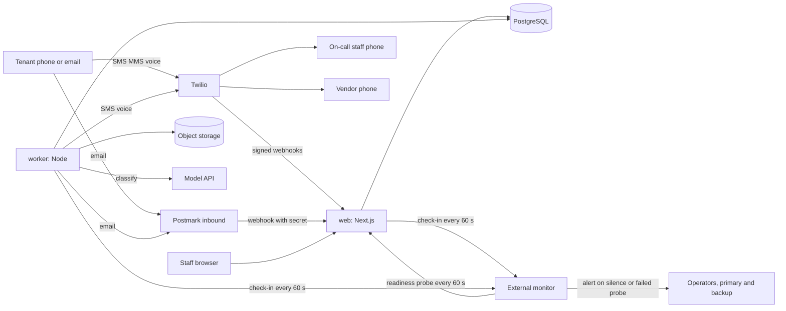
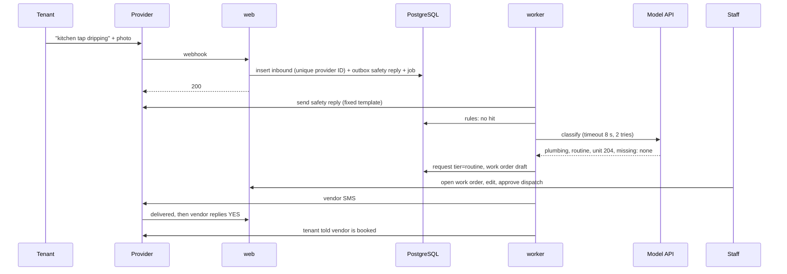
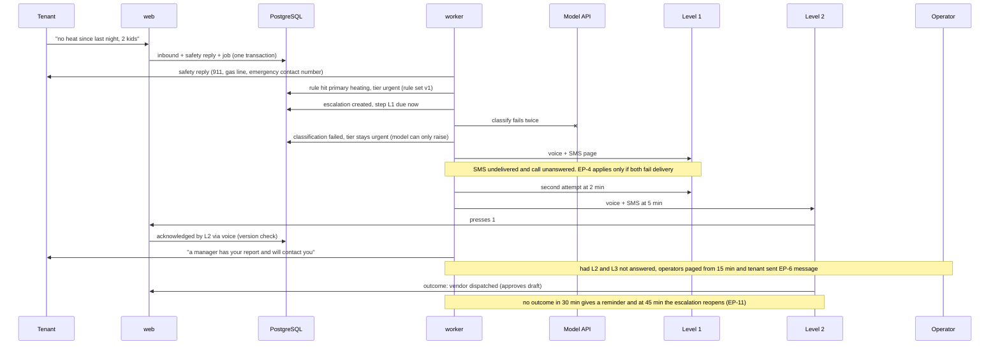

# TRD — FixTriage

arc42 order. Labels as in [Decision.md section 0](Decision.md#0-how-numbers-are-labelled-used-in-all-ten-files). The whole stack is a proposal `[P]`; the brief's stack was "a suggestion, not a decision" `[C]`. Product rules (UR, EP, DU, FD, HI) are defined once in [PRD section 7](PRD.md#7-product-rules-canonical-other-files-cite-these-ids). Nothing here is implemented; every command is **proposed**.

## 1. Introduction and goals

Quality goals in priority order: (1) no urgent case missed or delayed (HCF, [PRD section 1](PRD.md#1-overview)); (2) no personal information crosses accounts; (3) every automated decision is reconstructible; (4) one developer can run and operate it.

## 2. Constraints

| Constraint | Source |
|---|---|
| Human approves every vendor dispatch; no autonomous booking | `[C]` |
| Tenants and vendors have no login and no app | `[C]` |
| Urgency floor, dates, business hours, access and escalation routing are deterministic code | SPEC; UR-5, EP |
| Safety reply has no AI or classification dependency | MH-02 |
| Stored data in Canada | `[C]` selling point, reduced by GAP-08 |
| Canadian SMS sender rules | `[S: SRC-09, SRC-11]`, AD-08 |
| Fixed cost assumption CAD 740 a month | 700 `[C]` plus 40 `[A]` for the external monitor and platform probe (Decision.md 7.1); hosting below is not priced at source `[A]` |

## 3. Context and scope

| External system | Used for | Trust |
|---|---|---|
| Twilio | Inbound and outbound SMS and MMS, voice pages with keypress, inbound call forwarding, delivery callbacks | Webhooks verified by signature; content untrusted |
| Postmark | Inbound email with attachments, outbound email, delivery events | Webhook secret; content untrusted |
| Model API (Anthropic, Haiku class `[S: SRC-19]`) | Classification, extraction, drafting | Output untrusted; never authoritative for tier floor |
| External monitor (hosted dead-man and uptime service with its own phone and push alerting; product choice deferred) | Receives check-ins, probes readiness, watches provider status feeds, alerts the operators | Runs outside our infrastructure and does not use our Twilio account |
| Object storage | Photos, exports | Private; presigned URLs only |

## 4. Solution strategy

- AD-01: one TypeScript repository, two deployables (`web`, `worker`) sharing three packages. No microservices.
- AD-03: escalation is rows with due times in PostgreSQL, advanced by a polling worker, never in-memory timers.
- AD-04: rules before model; final tier is the highest; humans alone lower it.
- AD-05: the safety reply is enqueued in the same transaction that stores the inbound message.
- AD-12: every outbound message goes through one outbox with delivery tracking.

## 5. Building block view

| Block | Responsibility | May import |
|---|---|---|
| `apps/web` | Next.js App Router with Tailwind `[C]`: staff UI, JSON API, webhooks, capability-link pages | `packages/*` public entry points only |
| `apps/worker` | Jobs: classify, outbox send, escalation tick, dispatch watch, digest, retention, platform probe, export, media fetch; sends a check-in to the external monitor every 60 s | `packages/*` public entry points only |
| `packages/core` | Pure domain: rule engine, tier ordering, escalation state machine, duplicate matching, business-hours calendar, metrics | nothing from `apps`, no I/O |
| `packages/db` | Drizzle schema, migrations, the only account-scoped query helper, RLS session setup | `packages/platform` |
| `packages/platform` | Configuration, logger, correlation context, provider clients, storage keys, public URL builder | no framework imports |
| `packages/services` | Transactional workflows shared by both deployables: intake (T1, T2), classify job, escalation tick and acknowledgement (T3, T4, T6), outbox, dispatch (T5), readiness. Added in B1 because `packages/db` may not import `packages/core` and apps may not import each other | `packages/core`, `packages/db`, `packages/platform`; no framework imports |

Apps never import each other or package internals (R-04); configuration, logging and key building exist only in `packages/platform` (R-03, R-06, R-07). B1 layout: all blocks live under `code/` (npm workspaces), because the repository root keeps only the planning files, `.gitignore` and `Makefile`; `code/tools/monitor-fake` stands in for the external monitor in tests and local runs.

### 5.1 API contracts

All staff routes need a session and derive `account_id` from it, never from the request. Errors use `{error:{code,message,correlation_id}}`. Mutations take an `Idempotency-Key` header.

| Route | Purpose | Notes |
|---|---|---|
| `POST /webhooks/twilio/sms` | Inbound SMS or MMS | Verify signature; insert `inbound_messages` unique on `(provider, provider_message_id)`; same transaction enqueues safety reply and classify job; respond 200 within 2 s |
| `POST /webhooks/twilio/status` | Delivery status | Forward-only status rank; unknown ID is stored and retried |
| `POST /webhooks/twilio/voice` | Inbound call to the SMS number | Returns call-forward to the account emergency contact number (MH-16) |
| `POST /webhooks/twilio/voice-ack` | Keypress on a page call | "1" acknowledges the escalation step that placed the call |
| `POST /webhooks/postmark/inbound`, `/delivery` | Inbound email, delivery events | Secret header; unique on Postmark message ID |
| `GET /api/requests`, `GET /api/requests/:id` | Inbox, detail | Cursor pagination; filters in the URL |
| `POST /api/requests/:id/correct` | Correct trade, tier, unit | Lowering a tier needs a reason (UR-6) |
| `POST /api/requests/:id/assign-unit` | Unknown sender (HI-6) | |
| `POST /api/requests/:id/review` | Review mark (MH-13) | |
| `POST /api/incidents/:id/ack`, `/outcome`, `/downgrade` | EP-7, UR-6 | Optimistic `version` |
| `POST /api/incidents/:id/merge`, `/unmerge` | DU-5 | |
| `POST /api/work-orders/:id/approve-dispatch` | FD-1 | Body carries the exact text hash and vendor ID shown to the user |
| `POST /api/dispatches/:id/redispatch` | FD-3 | Human chooses the vendor |
| `GET/PUT /api/settings/on-call` | EP-1, EP-9 | Rejects a gap |
| `/api/settings/vendors`, `/properties`, `/account`, `/users` | CRUD and CSV import | Import is a job with per-row results |
| `POST /api/exports`, `GET /api/exports/:id` | CSV export job | |
| `GET /api/review/report` | SM-01, SM-03, SM-04 | |
| `POST /api/privacy-requests` | MH-15 | |
| `GET/POST /a/:token` | Acknowledge link | Capability token; GET shows, POST acts |
| `GET/POST /v/:token` | Vendor confirm or decline | Capability token |
| `GET /healthz`, `GET /readyz` | Liveness; readiness: database, queue, storage, **and** age of the oldest due escalation step, oldest pending outbox row and oldest `classify` job (fails above 60 s), so a running but stuck worker is visible from outside | Probed by the external monitor |
| `/ops/*` | Operator console | `operator` role, separate audit |

## 6. Runtime view

### 6.1 Normal sequence (routine request, business hours)

### 6.2 Highest-consequence failure sequence (HCF)

02:10, no heat reported by text; the model API is down; the Level 1 phone is off.

### 6.3 Jobs, retries, timeouts, idempotency

| Job | Trigger | Timeout / retries | Idempotency key | On exhaustion |
|---|---|---|---|---|
| `outbox.send` | Outbox row `pending` | 10 s; 3 tries over 60 s | `outbound_messages.dedupe_key` | Row `failed`; pages and safety replies raise an operator alert; a failed page counts as a failed channel (EP-4) |
| `intake.process` (B1) | Inbound stored (T1 enqueues it with the safety reply) | 5 tries, backoff | `inbound_message_id` | Dead job; `/readyz` job age fails at 60 s |
| `classify` | `intake.process` done | 8 s per call, 2 tries, 20 s total | `(inbound_message_id, model_version)` | Tier `uncertain` (UR-3) |
| `escalation.tick` | Every 15 s | 10 s; single-flight per escalation by row lock | `(escalation_id, cycle, level, attempt)` unique | Missed tick is caught by the next; lateness alert at 60 s |
| `dispatch.watch` | Every 30 s | — | `(dispatch_id, check)` | FD-4; for an emergency dispatch it creates a reopened escalation with trigger `dispatch_failed` (EP-11b), unique per dispatch |
| `media.fetch` | MMS or email attachment | 30 s; 5 tries | `(inbound_message_id, index)` | Attachment `unavailable`, shown to staff; text still processed |
| `digest.daily`, `retention.sweep` | Schedule | Resumable by cursor | `(account_id, date)` | Operator alert |
| `export.build` | User | 5 min | `export_id` | Export `failed`, retry button |
| `probe.run` | Every 6 h, platform numbers only | 5 min to see the round trip | `probe_run_id` | Failed probe makes `/readyz` fail, which the external monitor alerts |
| check-in (not a queue job) | `web` and `worker` main loops, every 60 s | 5 s | — | Nothing to do in-process: silence is detected by the external monitor after 180 s |

Rules for events and timeouts:
- Out-of-order or duplicate events (R-01): state columns move only forward by a rank table; every transition checks `version`; a late `delivered` after `failed` is recorded but does not undo an escalation advance.
- Caller timeout (R-02): an outbound send whose result is unknown is reconciled by provider lookup of the stored reference. If still unknown, a **page or safety reply is sent again** (a duplicate page is acceptable, a missing one is not) and a **vendor dispatch is not** (it is shown to the approver as "delivery unknown"). A model answer that arrives after the timeout is stored and may raise the tier, never lower it.
- Webhook handlers do no network I/O other than the database.

## 7. Deployment view

| Aspect | Local | Staging | Production |
|---|---|---|---|
| Runtime | Proposed: Docker Compose: PostgreSQL, S3-compatible store, provider fakes; `web` and `worker` run from source. B1 build machine (no Docker): local PostgreSQL 16 database `fixtriage_dev`, role `fixtriage_app`; storage and providers are in-process fakes | AWS ca-central-1, ECS Fargate, one task each | Same, two `web` tasks, two `worker` tasks |
| Data | Synthetic fixtures | Synthetic only | Real; RDS PostgreSQL in two zones, encrypted |
| Providers | Fakes with recorded payloads | Twilio test sub-account, test numbers, Postmark sandbox server, model API with test key | Live |
| Public URL | `PUBLIC_BASE_URL=http://localhost:8109` (B1 web port) | staging host name | production host name; all links built from this value (R-16) |
| Secrets | `.env.local`, never committed | AWS Secrets Manager | AWS Secrets Manager, rotated on staff change |
| Start | `npm run dev` from `code/` (exists since B1; replaces the proposed `pnpm dev`): role, migrations, rule-set seed, fake monitor (3109), web (8109), worker, health wait | Pipeline | Pipeline with manual approval |

The founder's VPS `[C]` is not used for personal information: a single host has no managed backup or second zone `[P]`.

- Deployment: image per commit; migrations run as a separate one-off task before the new version starts; expand-then-contract schema changes only.
- Rollback: redeploy the previous image tag; because migrations are additive within a release, the previous image runs on the new schema. Rollback is rehearsed in T-3.1.5.
- Backup and restore: RDS point-in-time recovery, 7 days; daily snapshot kept 35 days; object storage versioning with 35-day expiry of old versions. Restore drill before go-live and quarterly: restore to a new instance, run the row-count and escalation-integrity checks, replay the deletion log ([schema.md section 8](schema.md#8-export-deletion-backup-expiry-restore)).
- Persistent state lives only in RDS and object storage; containers are stateless (R-15).
- Alert ownership: two named operators, primary (the founder) and backup, are required **before the first live account** (EP-5, EP-9); the backup may be a contracted after-hours answering service working from the runbook `[P]`. Who the second person is has not been decided (O-9). Alerts raised by the external monitor (never by the worker about itself): missed check-in from `web` or `worker`, failed readiness probe (which covers escalation tick lateness, outbox age and queue age above 60 s, failed platform probe), provider status change. Alerts raised by the application through the page path: escalation reaching Level 4, outbox failure for a page, dead-letter count above zero, failed backup.
- Incident response: acknowledge within 5 minutes; phone affected accounts' Level 3 if paging is impaired; fix or roll back; write up within 2 business days; replay affected inbound messages from `inbound_messages`. A suspected personal-information incident is reported to the account `owner` without delay `[P; BC PIPA text read has no breach-notification section, SRC-03]`.

## 8. Crosscutting concepts

### 8.1 Identity and sessions
Staff: email as identifier, password (minimum 12 characters, checked against a common-password list, stored with Argon2id at parameters taken from current OWASP guidance at build time) plus TOTP for every user; a TOTP code or recovery code is accepted once; recovery codes; reset requires TOTP or a recovery code. Lost second factor and no recovery code: the account `owner` re-enrols a `manager` after signing in with both factors; an `owner` is re-enrolled only by an operator after a call-back to the brokerage's office number on the BCFSA register and a second operator's approval, both audited (the same evidence as at enrolment, when the owner is set up on a call to that number). State-changing routes require the session cookie (`SameSite=Lax`) and a per-session anti-forgery token in a custom header; requests without it are rejected. No magic links and no SMS codes (departure from the brief's "magic links" `[C]`). Sessions: opaque random tokens stored hashed in the database, `__Host-` cookie, inactivity timeout 8 hours, absolute lifetime 7 days, ended on sign-out and when a user is disabled. Tenants and vendors are not authenticated; they are identified by sender address and by capability tokens.

Capability tokens (acknowledge link, vendor link): 256-bit random, stored hashed, single purpose, expiring (acknowledge: incident close or 24 hours; vendor: 7 days). The acknowledge page shows street address, hazard class and tier, never tenant name, number or message text.

### 8.2 Tenancy (account isolation)
Every account-owned table carries `account_id`. PostgreSQL row-level security is enabled and forced on those tables; the application role cannot bypass it. `packages/db` exposes `withAccount(accountId, fn)`, which opens a transaction and sets `app.account_id`; all reads and writes of account data happen inside it. Jobs carry `account_id` in the payload. Storage keys start with the account ID (AD-10). Nothing is cached across requests in the MVP.

The account is not known at a few entry points. Each has one named database function or view, owned by a separate role, returning only the listed columns; they are the **only** access outside `withAccount`, are listed in [schema.md section 4](schema.md#4-permissions-account-boundary-uniqueness), and are covered by IT-10:

| Entry point | Function or view | Returns |
|---|---|---|
| Inbound webhook | `resolve_channel(address)` | `account_id`, `channel_id` |
| Session cookie | `resolve_session(token_hash)` | `user_id` or `operator_id`, `account_id`, `role`, expiry |
| Sign-in | `resolve_login(email)` | `user_id`, `account_id`, password hash, TOTP state |
| Capability link | `resolve_capability(token_hash)` | `account_id`, purpose, target IDs, `user_id`, expiry |
| Delivery-status webhook | `resolve_outbound(provider_message_id)` | `account_id`, `outbound_message_id` |
| Worker polls | views `due_escalations`, `pending_outbox`, `due_dispatches`, `sweep_accounts`, `due_jobs` (B1) | `id`, `account_id`, due time only (`pending_outbox` also `next_attempt_at`) |

After resolution the handler or job enters `withAccount` for that account before reading anything else.

### 8.3 Configuration and secrets
One typed configuration module validates the environment at startup for both deployables and exits on error. Product constants (EP timings, DU windows) are versioned code in `packages/core`, not environment variables; per-account settings live in the database within bounds (acknowledgement timeout 3-10 minutes).

### 8.4 Audit, logging, correlation
`audit_events` is append-only and records actor, action, object, before and after, rule or model version and correlation ID. A correlation ID is created at webhook or request entry, stored on the inbound message, copied into every job payload and outbound message, and printed in every log line (R-12). Logs hold IDs and codes only: no message text, phone numbers, emails, names, tokens or addresses; a log-scrubbing test enforces this.

### 8.5 AI functions

| Aspect | Decision |
|---|---|
| Responsibility | Propose trade, tier, unit match and missing fields; describe photos; draft the work order summary and vendor message. Vision output can raise a tier only. |
| Not AI | Tier floor (rules), final tier (UR-5), safety reply, follow-up question wording (fixed bank), business hours, routing, timers, permissions, metrics. |
| Model | Hosted Haiku-class model `[C]`; the exact model identifier is pinned in configuration and read from provider documentation at implementation. Provider reached through one interface in `packages/platform` (AD-09). |
| Fixtures | 50 real requests collected with consent in Phase 0 `[C]`, labelled by two people; a synthetic emergency set of at least 200 messages across UR-1 and UR-2 triggers, misspellings, other languages and photo-only cases `[P]`; an injection set (messages instructing the model to mark itself routine). |
| Release gates | 90% correct trade and tier on the labelled set `[C]`; on the emergency set, the *final* tier (rules + model + uncertainty) is `life_safety`, `urgent` or `uncertain` for 100% of items `[P]`; on the injection set no item ends `routine` if a rule matched. |
| Human-review boundary | Every dispatch (FD-1); every `uncertain`; every downgrade; pilot review of every request (HI-9). |
| Fallback | Timeout, error, refusal or malformed output → `uncertain`. Provider outage does not affect MH-02, MH-03, MH-05. |
| Provider or model change | New version runs the full fixture suite in shadow against the pinned one; promotion needs the gates above and a recorded comparison; each classification row stores provider, model and prompt version. |
| Data | Message text and photos are sent to the provider; inference geography is "global" or "us" `[S: SRC-19]` (GAP-08). Disclosed in the pilot privacy schedule. |

### 8.6 Messaging sender plan (AD-08)

| Use | Sender | Reason |
|---|---|---|
| Tenant conversation, per account | Canadian local long code | Two-way, MMS, no registration listed for domestic long codes `[S: SRC-09]`; tenants reply to a local number. Risk: carriers filter A2P on long codes `[S: SRC-09]`; mitigated by delivery tracking (FD-2, FD-5) and low conversational volume. |
| Fallback and vendor messages | One toll-free number, verified before first use | Unverified toll-free traffic to Canada is blocked `[S: SRC-11]`; verification is task T-1.1.4 and sits on the critical path. |
| Pages | Voice call plus SMS | Voice is not subject to SMS filtering. |
| Recipients with US numbers | Verified toll-free number | US long-code traffic needs A2P 10DLC registration `[S: SRC-12]`, which is not planned. |
| Short code | Not used | 12-16 weeks and about USD 1,000 a month `[S: SRC-09, SRC-10]`. |

Outbound texts support `STOP` and `HELP` `[S: SRC-09]`; non-urgent texts are sent only in the recipient's daytime, urgent ones at any hour `[S: SRC-09: "unless the message is urgent"]`. After `STOP` the provider puts the number on a block list and every later text to it fails with error 21610 until the tenant sends `START` `[S: SRC-21]`; the application cannot override this, so FD-7 defines the remaining safety path (configured opt-out confirmation text, email, staff phone call, page). The wording of the opt-out confirmation is set per number where the provider allows it; that it can carry the 911 line on a Canadian long code is to be confirmed in T-1.1.4 `[A]`.

### 8.7 Security controls selected from OWASP ASVS 5.0.0 `[S: SRC-16]`

A planned control is not compliance. Status of every row: **planned, not verified**.

| Requirement | Planned control |
|---|---|
| V6.2.1, V6.2.4 | 12-character minimum; common-password check |
| V6.3.1, V6.1.1 | Rate limit and lockout policy documented and applied to sign-in |
| V6.3.3 | Password plus TOTP for all staff |
| V6.4.3 | Reset cannot bypass TOTP |
| V6.4.4 | Lost second factor: identity proofing by call-back to the registered office number and two-operator approval (8.1) |
| V6.5.1 | TOTP codes and recovery codes accepted once; last accepted time step stored |
| V11.4.2 | Argon2id for passwords, parameters from current guidance |
| V3.5.1, V3.3.2 | Anti-forgery token in a custom header on every state-changing route; `SameSite=Lax`, `Secure`, `__Host-` session cookie; capability-link POSTs carry the token itself and no cookie |
| V7.2.1, V7.2.4, V7.4.1, V7.4.2 | Server-side session verification, rotation at sign-in, invalidation at sign-out and on disable |
| V7.3.1, V7.3.2 | 8-hour inactivity, 7-day absolute timeouts |
| V8.1.1, V8.2.1, V8.2.2, V8.3.1, V8.4.1 | Role matrix in schema.md; object checks server-side; RLS for cross-account denial |
| V2.2.1, V2.2.2 | Server-side validation of all inputs, including webhook payloads |
| V2.4.1 | Per-sender and per-account inbound rate limits; excess is stored and flagged, never dropped |
| V5.2.1, V5.2.2, V5.3.2 | Size limits; type check by content; images re-encoded; generated storage keys |
| V12.2.1, V3.4.1 | TLS everywhere; HSTS |
| V13.3.1 | Secrets manager; nothing in source |
| V14.2.1 | No personal data in URLs or query strings |
| V16.2.1, V16.2.5, V16.3.1, V16.3.2 | Structured logs with correlation ID; no sensitive data; authentication and failed authorization logged |

**Not met, accepted for the pilot (three requirements):** V6.3.4 in part — acknowledge links and voice keypresses act without authentication, by design, limited to acknowledging one escalation; V14.2.1 for capability links — the token is in the URL path; V5.4.3 — no antivirus scan of tenant attachments (non-image files are stored and never served inline). Separately, V6.3.6: the plan is not to use email as an authentication factor (reset links are delivered by email and still require TOTP); this is planned and unverified like every other row, not satisfied.

### 8.8 Threat model

| Asset | Boundary | Abuse case | Proposed control |
|---|---|---|---|
| Tenant messages, photos, phone numbers, addresses | Internet → webhook | Forged webhook injects or floods requests | Signature or secret check; rate limits; per-account quotas with flag-not-drop |
| Urgency decision | Tenant text → model | Text tells the model to rate itself routine, or a prankster triggers pages | Rules set the floor; injection fixtures; per-sender page rate shown to staff, pages never suppressed automatically |
| Escalation chain | Staff → settings | A staff member removes people from the schedule | EP-9 gap rejection; audit; owner notified of every schedule change |
| Urgency and paging | Staff browser session | A forged cross-site request downgrades an incident or approves a dispatch, stopping a page | Anti-forgery token and SameSite cookie (V3.5.1, V3.3.2); downgrade needs a typed reason; audit |
| Acknowledgement | SMS link | Link forwarded or guessed | 256-bit token, single purpose, minimal data, expiry |
| Other accounts' data | API, worker, storage | ID guessing; job run under the wrong account | RLS; `withAccount`; keys prefixed by account; cross-account tests |
| Vendor link | SMS to vendor | Vendor link exposes tenant details to the wrong person | Shows only what the approver approved; expiry |
| Operator access | `/ops` | Support staff browse tenant data | Separate role, reason required, audited, visible to the account owner |

### 8.9 Liveness and channel monitoring

Rule: **nothing watches itself.** The worker cannot report its own death, so detection lives in an external monitor.

| Failure | Signal | Interval | Worst-case time to alert |
|---|---|---|---|
| `worker` or `web` process dead | Check-in stops | Check-in every 60 s; alert after 180 s of silence; monitor cycle up to 60 s | 60 + 180 + 60 = 300 s |
| Worker alive but not advancing (stuck tick, outbox, queue) | `/readyz` fails when the oldest due item is older than 60 s | Probe every 60 s; alert on two consecutive failures | 60 + 120 + 60 = 240 s |
| Provider-declared outage (Twilio, Postmark) | Provider status feed watched by the monitor | Per the monitor, assumed ≤ 5 min `[A]` | 5 min after the provider posts |
| Fault on one account's own number or forwarding | None. S-15 shows the last real inbound time; no alert | — | Not detected — a stated gap (MH-16(f)) |
| Silent platform-wide provider-path failure (webhooks not arriving) | Platform probe: one text to a probe number and one reply, plus one inbound email | Every 6 h | 6 h 5 min — a stated gap; mitigated by provider webhook-failure alerts where available `[A]` and by tenants' unchanged emergency phone |
| On-call phone dead | Weekly test page per person | 7 days | 7 days; mitigated by EP-3..EP-5 |

No per-account synthetic message is sent (cost in Decision.md 7.1). The monitor alerts the primary and backup operators by its own phone call and push notification. Operator action on any alert: turn on the S-15 banner for affected accounts and phone their Level 3.

## 9. Architecture decisions

| ID | Decision | Alternative rejected | Revisit when |
|---|---|---|---|
| AD-01 | TypeScript monorepo, Next.js `web` and Node `worker` | Python FastAPI backend `[C option]`: second language for one developer | Team grows |
| AD-02 | PostgreSQL 16 is the only durable store; pg-boss queue inside it. B1: a plain `jobs` table polled through view `due_jobs` replaces pg-boss (same transactional enqueue, account-scoped with RLS, no extra schema owned by a library); Redis is not used | Redis queue: second stateful service, no transactional enqueue | Queue age target missed |
| AD-03 | Escalation steps as rows polled every 15 s | In-memory or provider-side timers: lost on restart | — |
| AD-04 | Rules before model, highest tier wins, human-only downgrade | Model-only urgency | Never without new evidence |
| AD-05 | Safety reply enqueued in the ingest transaction | Reply after classification | — |
| AD-06 | AWS ca-central-1 (ECS Fargate, RDS, S3) | Fly.io Toronto `[C option]`, Supabase `[C option]`, founder VPS `[C]`: managed backups and two zones not confirmed there | Cost exceeds the fixed-cost assumption |
| AD-07 | In-application password plus TOTP | Clerk or Supabase Auth magic links `[C option]`: email as sole factor, user data outside Canada | Customer asks for single sign-on |
| AD-08 | Sender plan in 8.6 | Short code; toll-free only | Delivery failures above 2% |
| AD-09 | Model provider behind one interface, version pinned | Direct calls from jobs | — |
| AD-10 | Storage key `acct/{account_id}/{purpose}/{yyyy}/{mm}/{uuid}`; purpose in `inbound`, `export`, `tmp` | User file names in keys | — |
| AD-11 | No autonomous dispatch, including the second vendor | Auto-failover to next vendor | PRD section 13 evidence |
| AD-12 | Single outbox with delivery state | Direct sends from handlers | — |

Deferred: external monitor product choice (before T-2.2.7); payments (manual invoices in the pilot); infrastructure-as-code tool; whether to add a Canadian-region model route (GAP-08).

## 10. Quality requirements (all targets proposed)

| Attribute | Workload | Target | Future verification |
|---|---|---|---|
| Safety reply latency | 30 inbound messages in 10 minutes for one account (building outage) | p99 ≤ 60 s from provider receipt | IT-02 with provider fake timestamps |
| First page latency | Same burst, rule-triggered | p95 ≤ 60 s; model path ≤ 120 s | IT-05 |
| Escalation timer lateness | 20 concurrent escalations, worker restarted mid-run | p99 ≤ 30 s late, none skipped | IT-06 |
| Queue age | 20 accounts x 50 requests a month `[C]`, burst as above | Oldest `classify` job ≤ 60 s | Load script in T-3.1.2 |
| Inbox response | 5,000 requests in one account | p95 ≤ 500 ms | E2E timing |
| Ingest availability | Monthly | 99.9% (about 43 minutes down) | External monitor history |
| Failure detection | `worker` killed; escalation step stuck; provider path silently broken | Operators alerted ≤ 5 min for the first two; ≤ 6 h 5 min for the third | IT-16; probe history |
| Data loss | Database failure | RPO ≤ 5 minutes | Restore drill |
| Restore time | Region-internal restore | RTO ≤ 2 hours | Restore drill |
| Isolation | 2 accounts, all routes and jobs | 0 cross-account reads or writes | IT-10 |

Operating cost per account is the `[C]` assumption in Decision.md 7.1; infrastructure prices were not read at source.

## 11. Risks and technical debt

Production risks R-01..R-22 live only in the [verification file](verification-report-fixing.md#6-production-risk-register). Debt accepted: no voice intake; one region; no antivirus scan; capability links; single operator during the pilot.

## 12. Glossary

Account: paying brokerage. Tenant: renter. Request: one tenant's report. Incident: one real-world problem, possibly several requests. Escalation: the paging process for an incident. Page: voice call plus SMS to a staff phone. Dispatch: an approved message to a vendor. After hours: outside the account's configured business hours in `America/Vancouver`, including holidays the account lists.
