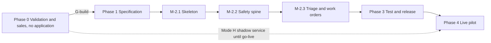

# Execution plan — FixTriage

Structure: phase → milestone → task → subtask. Labels as in [Decision.md section 0](Decision.md#0-how-numbers-are-labelled-used-in-all-ten-files). Estimates are author estimates `[A]` in hours. Nothing below has been done. Every script and command is **proposed**. Owners: **F** founder (also `operator`), **D** developer, **B** buyer (managing broker), **R** buyer's reviewer.

## 1. Sequence and gates

- **No build task starts before gate G-build** ([Decision.md 9.3](Decision.md#93-proposed-revision-p--a-change-to-the-chats-rule-not-a-restatement)): at least 1 paid pilot invoice paid, and G-interview and G-incumbent both decided (at least 6 gate interviews) and passed.
- **One go-live point** (the same sentence as [Decision.md 5.1](Decision.md#51-how-a-paid-pilot-is-delivered-before-software-exists)): an account goes live only after milestone M-3.1 has passed its exit criteria, which requires every task of Phases 1-3, and the account has passed its own go-live gate (EP-9). There is no smaller "pilot slice": every must-have is P0, because the offer promises categorised work orders, a vendor draft, digest and export, and the refund test measures classification. M-2.2 is an internal milestone, not a go-live point.
- Critical path: T-0.1.1 → T-0.1.2 → T-0.2.1 → T-0.2.3 → T-0.2.4 → T-1.1.1 → T-2.1.2 → T-2.2.1 → T-2.2.4 → T-2.2.6 → T-2.3.1 → T-2.3.6 → T-3.1.1 → T-3.1.2 → T-3.1.5 → T-4.1.1. T-1.1.4 (toll-free verification) is on the critical path by calendar time, not effort.
- Parallel: T-0.1.4 with outreach; T-1.1.2 and T-1.1.3 with T-1.1.1; T-2.1.3 with T-2.1.2; T-2.2.5 and T-2.2.7 with T-2.2.4; all of M-2.3 except T-2.3.6 in parallel after M-2.2 for a second developer.
- External dependencies: payment (T-0.2.3), sample data and consent (T-0.1.4), buyer decision (T-0.2.3, T-4.1.4), permissions (privacy schedule T-1.1.3; sender verification T-1.1.4).
- Hours: Phases 1-3 total **307-427** (Phase 1: 21-33; M-2.1: 41-56; M-2.2: 96-134; M-2.3: 94-128; Phase 3: 55-76) against the brief's 140 hours / 18 days `[C]` (GAP-06). **All 307-427 hours precede the first live account.** The total was 286-397 before the scope added in fix round 1 was estimated: T-2.1.2 +3-4 (resolvers), T-2.1.3 +3-4 (anti-forgery, lost factor, operator sign-in), T-2.2.4 +6-8 (reopened escalations, operator roster), T-2.2.7 +2-4 (external monitor, probe), T-2.2.8 +2 (DU-4), T-2.3.10 +2-4 (FD-7), T-3.1.1 +3-4 (IT-19..IT-21).
- Calendar (4-week months from 2026-11-16, same as Decision.md 7.5): batch 1 weeks 1-4; G-build read by week 7; build from week 8 to weeks 16-19 with one full-time developer (307-427 hours at 40 a week is 7.7-10.7 weeks); **first live account in month 5** (weeks 17-20). If G-build is undecided at week 7 (probability about 0.40, Decision.md 9.3) everything after it moves by the time batch 2 takes.
- Phase 0 founder hours: the brief gives 70 per batch `[C]`. The tasks below sum to 76-98 for the first batch; 12-16 of that is one-off fixture work (T-0.1.4, T-0.2.5), leaving 64-82 (midpoint 73) per repeating batch, excluding Mode H at 4 hours per pilot week. Decision.md 7.3 uses 73.

## 2. Phase 0 — Validation and go-to-market (no application exists)

### M-0.1 Prospect list and discovery
Entry: none. Dependencies: none. Owner: F. Outcome: 300 distinct firms contacted, gate interviews held (7.2 expected, 10 targeted, 6 needed), pool size counted. Exit: G-interview and G-incumbent evaluated and recorded, or recorded as undecided with the interview count; G-channel evaluated.

| ID | Need | Owner | Est. | Deliverable | Acceptance check | Subtasks |
|---|---|---|---|---|---|---|
| T-0.1.1 | Decision 8, 10.3 | F | 10-14 | Prospect sheet of at least 300 distinct BC rental-management firms, and the total count found | Deduplicated by licence number; 20 random rows match the register; count of the whole pool written down, or "could not be counted" with reason | Run BCFSA search by city with the rental property management filter; add LandlordBC, PAMA, Google Maps; record source, date, public email and phone, consent basis; drop strata-only |
| T-0.1.2 | Decision 10.4 | F | 14-18 | Batch 1a: 150 firms emailed, called on day 3 | Send log with dates; replies classified; unsubscribes honoured the same day | Mail-merge the first-touch message; day-3 calls mid-morning; day-7 follow-up; log outcomes |
| T-0.1.3 | G-interview, G-incumbent, SM-02 and SM-08 baselines | F | 10-12 | Notes for every gate interview held (expected 7.2 meetings per batch; target 10; minimum 6 for the gates to be decidable), including answered day-3 calls where the three gate questions were asked | Each note answers the five discovery questions `[C]` plus: hours a month on intake, would pay CAD 99, current software and whether it triages after hours at no cost, last after-hours incident and time to reach a person, share of after-hours contacts by phone call, who could be Level 1 and Level 2 | Schedule; call; write up within 24 h; tally gates |
| T-0.1.4 | TRD 8.5 fixtures | F | 6-8 | 50 real requests with consent `[C]` | Each has written permission from the firm, names and numbers removed before leaving the firm; stored outside the repository | Consent note; collection; second-person labelling of trade and tier |

### M-0.2 Hand-run test and pilot sale
Entry: at least 3 replies. Dependencies: T-0.1.2. Owner: F. Outcome: paid pilot commitments. Exit: G-build decided in writing: build, run another batch, or stop.

| ID | Need | Owner | Est. | Deliverable | Acceptance check | Subtasks |
|---|---|---|---|---|---|---|
| T-0.2.1 | Free first step | F | 8-10 | Three-request test for up to 10 firms `[C]` | Work orders returned by 10:00 next business day; each shows tier, rule that fired, questions that would be asked, draft vendor text; prospect's verdict per request recorded | Fixed prompt and rule list; hand check of every tier against PRD 7.1; send; follow-up call |
| T-0.2.2 | Decision 10.4 | F | 14-18 | Batch 1b: 150 more firms | Same as T-0.1.2; cumulative 300 | Same |
| T-0.2.3 | Pilot offer | F, B | 6-8 | Signed pilot agreement and paid CAD 99 invoice per pilot | Agreement states price, 30 live days, refund rule in the words of SM-03 (all marked requests, unclear ones count as not correct, only the named reviewer's explicit marks) and SM-01, the named reviewer, buyer inputs, Mode H and Mode L with the expected go-live month, the monitoring limits in the words of MH-16(c) and (f) (a silent provider-path failure is caught only by a 6-hourly platform probe, a fault on this account's own number is not probed, SM-01 cannot count messages that never arrive, the emergency phone stays the tenants' route), what happens to texts after a tenant sends `STOP` (FD-7), privacy schedule, cancellation with full refund before go-live; invoice paid | Draft one-page agreement and privacy schedule; send; collect signature and payment; record expected Mode L date |
| T-0.2.4 | Stop rule | F | 2 | Gate record | States counts for G-interview, G-incumbent, G-channel, G-build and the decision; if build, confirms the scope is MH-01..MH-16 and nothing else (R-21) | Tally; decide; file in the coordination folder |
| T-0.2.5 | TRD 8.5 | F | 6-8 | Labelled set (50) and synthetic emergency set (200+), injection set | Two labellers agree or disagreement is recorded; every UR-1 and UR-2 trigger has at least 5 items including misspellings and one non-English item per language named by pilot buyers | Write; label; review |
| T-0.2.6 | Decision 5.1 | F | 4 per pilot week | Mode H shadow service | Buyer forwards copies; work orders returned by 10:00 next business day; no tenant or vendor contacted; accuracy marks collected | Forwarding instructions; daily run; weekly accuracy note |

## 3. Phase 1 — Specification and design

### M-1.1 Rules, designs, permissions
Entry: G-build passed. Dependencies: T-0.2.3, T-0.2.5. Owner: F. Outcome: rule set v1 and escalation policy confirmed by each pilot buyer; sender verified. Exit: buyer sign-off on PRD 7.1-7.4 values for their account; toll-free verification approved; three core screens reviewed with one buyer.

| ID | Need | Owner | Est. | Deliverable | Acceptance check | Subtasks |
|---|---|---|---|---|---|---|
| T-1.1.1 | MH-03, MH-05 | F, B | 4-6 | Rule set v1 and policy values per pilot account | Buyer names Levels 1-3, confirms timeouts and emergency contact number; any request to weaken UR-5..UR-8 is refused and recorded; scope list unchanged (R-21) | Walk through PRD 7; record languages tenants use; update lexicon |
| T-1.1.2 | MH-05, MH-09; R-20 | D | 8-12 | Clickable sketches of S-03, S-05, S-06, S-07 | One buyer completes "acknowledge and dispatch" unaided; every label and route name matches App-flow | Sketch; test; fix labels |
| T-1.1.3 | MH-15 | F | 6-10 | Privacy pack: purpose notice text, privacy schedule, subprocessor list including model-provider location (GAP-08), retention table, request procedure | Buyer's designated privacy contact `[S: SRC-03, s.4(3)]` acknowledges it; open legal questions listed, not hidden | Draft from schema.md 7-8; review with buyer |
| T-1.1.4 | AD-08, FD-7, MH-16 | F | 3-5 | Twilio account, one local number per pilot account, two platform probe numbers, toll-free number submitted and approved, Postmark inbound address, external monitor account | Test SMS delivered to a phone on each of three Canadian carriers from each sender; approval recorded; `STOP` sent from a test phone: the confirmation text received is recorded word for word, a later text is confirmed blocked, `START` restores it; if the confirmation wording cannot carry the 911 line on a long code, FD-7(a) is struck and the agreement text says so | Buy numbers; submit verification; carrier tests; opt-out test; monitor trial; record results |

## 4. Phase 2 — Build

### M-2.1 Environment and skeleton (first build milestone)
Entry: M-1.1 exit. Dependencies: none external. Owner: D. Outcome: empty application that starts with one command, isolates accounts and signs users in. Exit: IT-10 and IT-14 pass; `/readyz` green locally and on staging.

| ID | Need | Owner | Est. | Deliverable | Acceptance check | Subtasks |
|---|---|---|---|---|---|---|
| T-2.1.1 | R-04, R-17 | D | 6-8 | Repository layout (TRD 5), proposed `pnpm dev`, health endpoints, import-boundary lint | Fresh clone to healthy web and worker with one command; lint fails on a cross-app or deep import | Scaffold; compose file with named volumes; boundary rule; health checks |
| T-2.1.2 | MH-14; R-05, R-08, R-09, R-11 | D | 15-20 | Migrations, Drizzle schema, RLS, `withAccount`, the resolver functions and views of schema.md 4, migration checks | IT-10, IT-14; a query without account context returns no rows; each resolver returns only its listed columns | Tables in schema.md order; policies; grants; ORM-diff check; backfill runner; concurrent-index convention |
| T-2.1.3 | MH-14 | D | 13-18 | Password + TOTP sign-in, sessions, roles, reset, anti-forgery token, lost-factor procedure, operator sign-in | UT and IT for the V3, V6, V7, V11 controls in TRD 8.7 including IT-21; disabled user's session rejected; a TOTP code is refused the second time | Argon2id hashing; TOTP enrol and verify with last-step store; recovery codes; rate limit; role guard; anti-forgery middleware |
| T-2.1.4 | R-10, R-22 | D | 3-4 | CI pipeline and branch rules | CI runs lint, tests, migration-order check; short-lived branches named `T-x.y.z-slug`; `main` protected; stale-branch report weekly | Workflow; branch protection; naming check |
| T-2.1.5 | R-03, R-06, R-07, R-12 | D | 4-6 | `packages/platform`: configuration, logger, correlation, scrubber | UT-11; worker starts with no web framework installed; one configuration module used by both | Config schema; logger; correlation propagation helper; duplicate-utility lint |

### M-2.2 Safety spine (internal milestone, not a go-live point)
Entry: M-2.1 exit. Dependencies: T-1.1.4 numbers. Owner: D. Outcome: a message can arrive, be answered with the safety reply, be tiered by rules, and page a chain until acknowledged, with no AI anywhere. Exit: E2E-03, E2E-04, E2E-05, IT-01..IT-09, IT-13, IT-16, IT-20 pass on staging with provider test accounts.

| ID | Need | Owner | Est. | Deliverable | Acceptance check | Subtasks |
|---|---|---|---|---|---|---|
| T-2.2.1 | MH-01 | D | 10-14 | Signed webhooks, idempotent ingest, media fetch | IT-01; unknown destination address is stored for the operator, never dropped | Twilio and Postmark handlers; signature checks; unique constraint; media job |
| T-2.2.2 | MH-02, MH-10; R-01, R-02 | D | 8-12 | Outbox, delivery tracking, fixed templates, safety reply with the 30-minute sender window, rule-hit resend and clock-selected after-hours variant | IT-02, IT-09, IT-13, UT-07, UT-10 | Outbox worker; status rank; reconcile-unknown rule; template registry with versions; sender-window query |
| T-2.2.3 | MH-03, MH-04 | D | 12-16 | Rule engine, lexicon v1, tier ordering, downgrade guard | UT-01, UT-02, IT-04; 100% of the emergency set ends non-routine by rules + uncertainty alone | Normalisation; lexicon; rule versions; database trigger for UR-6 |
| T-2.2.4 | MH-05, MH-06, MH-10; R-01 | D | 26-36 | Escalation state machine, tick job, voice and SMS pages, keypress acknowledgement, tenant notices, outcome reminder, reopened escalations (EP-11 a-c), Level 4 primary and backup with "engaged" and relayed acknowledgement (EP-5) | UT-04, IT-05, IT-06, IT-07, IT-08, IT-19 | Step scheduler; row locking; voice script; EP-4, EP-6, EP-7; reopen transaction; Level 4 roster |
| T-2.2.5 | MH-05 | D | 8-12 | S-09, coverage validation, test pages | UT-05, E2E-01 | Shift model; gap detector; test-page flow; owner notification |
| T-2.2.6 | MH-05, MH-06; R-16 | D | 10-14 | S-05, S-06, capability tokens, public URL builder | E2E-03; UT-09; link opens from a real phone on staging | Token issue and verify; minimal-data page; live timeline |
| T-2.2.7 | MH-16; R-07 | D | 10-14 | Check-ins from `web` and `worker` to the external monitor, readiness endpoint with due-item ages, monitor configuration (silence 180 s, probe 60 s, provider status feeds, alerts to both operators), 6-hourly platform probe, S-15 banner, S-16 Level 4 queue, inbound call forward | IT-16 | Check-in loop; readiness ages; monitor setup; probe job; call-forward response |
| T-2.2.8 | MH-07 | D | 12-16 | Threading, duplicate suggestion with link states, page rules of DU-4, building-wide flag, confirm, reject and unmerge | UT-06, IT-20, E2E-05 | DU-2 lock; DU-3 query; DU-4 rules; S-05 controls |

### M-2.3 Triage and work orders
Entry: M-2.2 exit (internal milestone). Dependencies: T-0.2.5 fixtures. Owner: D. Outcome: classified requests, approved dispatches, review and export. Exit: classifier gates in TRD 8.5 met; E2E-02, E2E-06, E2E-08 pass.

| ID | Need | Owner | Est. | Deliverable | Acceptance check | Subtasks |
|---|---|---|---|---|---|---|
| T-2.3.1 | MH-08, MH-04 | D | 14-20 | Model interface, prompts, evaluation harness | IT-03; gates in TRD 8.5; report stored per model version | Provider client; structured output check; `eval-classifier`; shadow comparison |
| T-2.3.2 | MH-08 | D | 6-8 | Follow-up question bank and flow | At most 3 questions; none for `life_safety`; answers thread into the request (DU-2) | Bank per trade; missing-field mapping |
| T-2.3.3 | MH-08, MH-13; R-18 | D | 14-18 | S-03, S-04 with correction | E2E-07; UT-02 | Sections; URL state; decision panel; correction with reason |
| T-2.3.4 | MH-01, MH-11; R-19 | D | 8-10 | S-11 import, unknown-sender assignment | IT-17 | CSV parser; per-row results; idempotent re-run |
| T-2.3.5 | MH-11 | D | 4-6 | S-10 | Order per trade persists; import as T-2.3.4 | Form; import |
| T-2.3.6 | MH-09, MH-10 | D | 16-22 | S-07, S-08, dispatch watch, failed-dispatch flow including the reopened escalation for emergency dispatches (FD-3) | IT-11, IT-12, IT-19, E2E-02 | Draft generation; review step with hash; vendor reply parsing; watch job |
| T-2.3.7 | MH-01; R-13 | D | 6-8 | Attachment storage, re-encoding, presigned viewing | UT-09; keys follow AD-10; oversized or wrong-type file is rejected and shown as such | Key builder; type check; image re-encode; signed URLs |
| T-2.3.8 | MH-12 | D | 6-8 | Digest and S-13 export jobs | Export of fixture matches expected CSV byte for byte; zero-row export completes | Digest template; export job; download link |
| T-2.3.9 | MH-13 | D | 8-10 | S-12 and metric computation | UT-08, E2E-08 | Last-night list; review queue; report and export |
| T-2.3.10 | MH-15, MH-02; R-14 | D | 12-18 | Retention sweep, tenant export and deletion, privacy log, `STOP` and the FD-7 safety path | IT-15, IT-18 | Sweep job; storage lifecycle; deletion log; S-14 forms |

## 5. Phase 3 — Test and release

### M-3.1 Proof before a real tenant texts
Entry: M-2.3 exit. Owner: D with F. Outcome: evidence for every must-have. Exit (this is the build side of the single go-live point): every test in section 7 passes; classifier gates met; restore and rollback rehearsed; alerts reach the operator's phone; verification file updated with results.

| ID | Need | Owner | Est. | Deliverable | Acceptance check | Subtasks |
|---|---|---|---|---|---|---|
| T-3.1.1 | All MH | D | 23-32 | Unit, integration and end-to-end suites in section 7 | All pass in CI; results linked in the verification file | Fixtures; provider fakes; Playwright flows |
| T-3.1.2 | HCF; TRD 10 | D, F | 6-8 | Failure drills on staging | Twilio fake down, model down, worker killed mid-escalation, chain exhausted: each ends with a human reached or the operator alerted within the EP times; burst load meets TRD 10 targets | `load-burst`; drill checklist; record timings |
| T-3.1.3 | design.md 7 | D | 4-6 | Accessibility checks | E2E-09 plus the manual checks in design.md 7 recorded pass or fail per row | Keyboard pass; screen-reader pass; contrast measurements |
| T-3.1.4 | TRD 8.7, 8.8 | D | 6-8 | Security checks | Each ASVS row in TRD 8.7 has a test or a recorded "not met" | Authentication and session tests; cross-account tests; webhook forgery; dependency audit |
| T-3.1.5 | R-15; TRD 7 | D | 10-14 | Staging and production environments, deploy, rollback rehearsal, backup and restore drill | Task recreated with no data loss; rollback to previous image works on the new schema; restore meets RTO and replays `deletion_log` | Provision; pipeline; `restore-drill`; rollback run |
| T-3.1.6 | MH-16, EP-5 | F, D | 6-8 | Monitoring, alerts, operator runbook, Level 4 call procedure, **two named operators (primary and backup) on the roster** | Each alert in TRD 7 and 8.9 fired once on staging and reached both operators' phones; the backup operator, not the author, runs the Level 4 dry run from the runbook; go-live is blocked while the roster has fewer than two (EP-9) | Alert rules; runbook; dry run |

## 6. Phase 4 — Live pilot

### M-4.1 Thirty live days per account
Entry (the single go-live point): M-3.1 exit; signed agreement; EP-9 go-live gate for the account. Dependencies: buyer inputs (Decision 5). Owner: F. Outcome: the decisive question answered with SM-01..SM-04 per account. Exit: pilot report delivered; refund decided by the rule; conversion decision recorded.

| ID | Need | Owner | Est. | Deliverable | Acceptance check | Subtasks |
|---|---|---|---|---|---|---|
| T-4.1.1 | MH-05 EP-9 | F, B | 3-4 per account | Account live | Checklist on S-02 complete; test pages acknowledged by every scheduled person; live inbound test on both channels; tenant notice sent by the buyer with the new address and number and the unchanged emergency phone | Import units; schedule; vendors; channel test; go-live |
| T-4.1.2 | SM-01, G-safety | F, R | 0.5 per day | Daily miss review | Every after-hours request audited by the operator by 10:00; reviewer clears S-12 "last night"; any miss triggers G-safety and a written cause within 2 business days | Audit; fix; replay |
| T-4.1.3 | SM-03, refund | F, B | 3 per account | Day-25 pilot report | Numbers match the S-12 export; refund issued within 10 business days when the rule says so | Export; call; refund if due |
| T-4.1.4 | SM-06 | F, B | 2 per account | Signed plan order form and first recurring invoice, or channel shutdown | Dated day 31 or earlier; shutdown checklist completed otherwise | Order form; payment method; invoice |
| T-4.1.5 | Decisive question | F | 4 | Pilot decision record | States, per account, SM-01, SM-02, SM-04 against baseline, and a yes or no to the decisive question with the evidence | Compile; decide; update Decision.md |

## 7. Tests (all `Not run`)

B1 (2026-11-11): the tests that have run, with commands and results, are recorded in [verification-report-fixing.md section 7](verification-report-fixing.md#7-build-milestone-b1-2026-11-11); every other test here is still `Not run`.

### 7.1 Unit

| ID | Fixture | Action | Expected |
|---|---|---|---|
| UT-01 | 200+ emergency messages incl. "no heet", "gas smel", "water thru ceiling", photo-only, non-English | Rule engine | Tier per label; none `routine` |
| UT-02 | Rule `urgent`, model `routine` conf 0.99; rule none, model `life_safety` | Final tier | `urgent`; `life_safety` |
| UT-03 | Hours Mon-Fri 09:00-17:00, holiday 2027-01-01, a clock change (the tz database shipped with Node 24.22.2, tzdata 2026e, has America/Vancouver at UTC-7 all year from 2026-03-08, so 2027-03-14 is not a change there; BC news release of 2 March 2026, Decision.md SRC-23; B1 tests Vancouver's 2026-03-08 change and America/Toronto's 2027-03-14 change; East Kootenay accounts use America/Edmonton, which still changes) | `isAfterHours` at boundaries | 16:59:59 false; 17:00:00 true; holiday true; correct across the clock change |
| UT-04 | Timeout 300 s | Schedule from t0 | Steps at 0, 2, 5, 7, 10, 12 min; primary operator at 15, backup at 20, both every 5 min until one engages; Levels 1-3 again from 30 min whether or not an operator engaged |
| UT-05 | Schedule with Saturday 00:00-08:00 Level 1 missing; schedule with one person on all levels | Validate | Gap named; "two different people" error |
| UT-06 | Reports at 0, 29, 31 min same sender; other sender same property 5 h 59 and 6 h 01 | Match | Append, append, new; suggest, no suggestion |
| UT-07 | Status events delivered → sent → failed after delivered | Apply | Stays `delivered`; late events recorded |
| UT-08 | 52 reviewer marks: 41 correct, 6 corrected, 5 on requests the system left `uncertain`; marks by a non-reviewer; approved-but-unmarked work orders; 19-mark case | SM-03 | 41 / 52 = 78.8% (refund); non-reviewer marks and unmarked approvals not counted; "below minimum" |
| UT-09 | Account, purpose, base URL | Build key and link | `acct/{id}/inbound/...`; link host equals `PUBLIC_BASE_URL`, never `localhost` in production config |
| UT-10 | Account with and without property override; 14:00 and 23:00; request later classed `routine` | Render safety reply | Contains "911", gas number, emergency phone; after-hours variant chosen by clock only; no "STOP" line in the safety text; no template contains "next business day"; module has no model import |
| UT-11 | Log lines with phone, email, message text | Scrub | None present in output |

### 7.2 Integration

| ID | Fixture | Action | Expected |
|---|---|---|---|
| IT-01 | Same Twilio payload twice, 50 ms apart | POST webhook | One row, one safety reply, both 200 |
| IT-02 | Model fake down, classify queue paused; same sender texts again at 10 min ("ok thanks"), at 20 min ("I smell gas") and at 3 h | Inbound SMS | Safety reply ≤ 60 s for the first; none at 10 min; sent again at 20 min (rule hit) and at 3 h (window passed) |
| IT-03 | 23:30, text with no rule hit, model timeout | Process | Tier `uncertain`; page started |
| IT-04 | "no heat", model answers `routine` | Process | `urgent`; page started |
| IT-05 | 30 messages in 10 min | Process | p95 first page ≤ 60 s; one incident chain per DU rules |
| IT-06 | Escalation at Level 1, kill worker for 90 s | Restart | Level 2 paged once; no step skipped or doubled |
| IT-07 | Level 1 SMS `undelivered`, call `failed` | Status webhooks | Level 2 paged immediately |
| IT-08 | Keypress and link POST within 100 ms | Acknowledge | One acknowledgement; second gets "already acknowledged" |
| IT-09 | `failed` then `delivered` for one message; status for unknown ID | Webhooks | Forward-only; unknown stored and retried |
| IT-10 | Accounts A and B | Every route and job with A's session or payload and B's IDs; storage read of B's key; every resolver function and poll view in schema.md 4 called directly with crafted inputs; a query on any account table outside `withAccount` | Not found or zero rows everywhere; resolvers return only their listed columns; the direct query returns nothing |
| IT-11 | Draft edited in another tab | Approve with old hash; double POST | Refused with reload; single dispatch |
| IT-12 | Emergency dispatch `undelivered` | Watch job | Escalation reopened with trigger `dispatch_failed`; approver and Level 1 paged with next vendor drafted; no message to vendor 2 |
| IT-13 | Provider times out on send | Page; dispatch | Page re-sent; dispatch shown "delivery unknown", not re-sent |
| IT-14 | Empty database; previous release; backfill killed at 40% | Migrate; diff ORM; resume | Clean; diff empty; resumes to 100% without duplicates; conflicting migration parents fail CI |
| IT-15 | Expired export, `tmp` object, closed request older than retention, deleted contact then restore | Sweep; restore | Objects and rows gone; deletion replayed after restore |
| IT-16 | External-monitor fake; (a) `worker` process killed; (b) worker running with the tick job blocked; (c) probe reply withheld; (d) inbound voice call | Advance clock | (a) both operators alerted ≤ 5 min with no worker running; (b) `/readyz` fails and alert ≤ 5 min; (c) alert after the failed 6-hourly probe; (d) call forwarded to emergency number |
| IT-17 | CSV of 100 units, 3 invalid | Import; fix; re-import | 97 added, 3 reported; re-run adds 3, duplicates none |
| IT-18 | Tenant with known email sends `STOP`, then at 23:00 texts "sink dripping" | Process | No text attempted (provider would return 21610); safety reply sent by email; request in needs-triage as "cannot be texted — phone the tenant"; Level 1 paged under EP-8; pages to staff unaffected; `START` restores texting |
| IT-19 | 02:30 emergency dispatch, vendor silent for 10 min; approver does not answer; second case: vendor SMS `undelivered` | Watch job; tick | Reopened escalation: approver and Level 1 at 0 and 2 min, Level 2 at 5, Level 3 at 10, operators from 15; Level 2 acknowledges; "Review next vendor" shown; no outcome in 45 min reopens again |
| IT-20 | Incident for unit 204 burst pipe acknowledged, no outcome yet; unit 305 texts "pipe burst" 10 min later; then incident marked building-wide and unit 406 reports | Process | Unit 305: linked as `suggested`, escalation reopened, acknowledger and Level 1 paged; "Separate problem" creates its own incident; unit 406 after the flag: no page, safety reply sent, listed on S-12 |
| IT-21 | Signed-in manager's browser; forged cross-site POST to `/api/incidents/:id/downgrade` and `/approve-dispatch` without the anti-forgery header | Send | Rejected; no state change; attempt logged |

### 7.3 End-to-end

| ID | Fixture | Action | Expected |
|---|---|---|---|
| E2E-01 | New account, schedule with a gap | Onboard | Go-live blocked naming the gap; passes after fix and test pages |
| E2E-02 | Routine request with photo | Approve dispatch; vendor replies YES; export | Tenant told; CSV row correct |
| E2E-03 | 02:10 "no heat", model down, Level 1 silent | Run | Safety reply; Level 2 acknowledges by link at about 5 min; outcome recorded; dispatch approved |
| E2E-04 | Nobody answers; primary operator silent | Run 31 min, then backup operator clicks "I am on it", then records "Accepted by phone" for Lee | Primary operator paged at 15 min, backup at 20; tenant EP-6 message; "I am on it" does not stop the 30-minute re-page of Levels 1-3; "Accepted by phone" ends the escalation with Lee as acknowledger and the operator as relay |
| E2E-05 | 5 tenants in 5 units, one building, "no heat": 3 before acknowledgement, 2 after | Run; acknowledger marks building-wide after the 4th | 5 safety replies; reports 1-3 share one chain with count 3 shown before any merge; report 4 reopens the escalation; report 5 attaches without a page; one work order; unmerge restores |
| E2E-06 | Photo only at 23:00; same at 14:00 | Run | Page at 23:00; triage queue at 14:00 then page at 15 min |
| E2E-07 | S-05 and S-07 mid-task | Refresh, Back, Forward, deep link signed out, session expiry | State kept; countdown correct; draft restored; no double send |
| E2E-08 | 25 requests, reviewer marks; one "was urgent" | S-12 | SM-03 with numerator and denominator; SM-01 = 1; operator alerted |
| E2E-09 | Keyboard and screen reader | Path "urgent after hours" | Completable; statuses announced; focus rules in design.md 7 |
| E2E-10 | `manager`; other account's URL | Edit S-09; open URL | Permission denied; not found |

## 8. Proposed scripts

B1: `pnpm` is not installed on the build machine; scripts are npm scripts in `code/package.json`. `pnpm dev` exists as `npm run dev` and `pnpm check:migrations` as `npm run check:migrations`; the others below are still proposed (AGENTS.md section 12).

| Script | Purpose | Inputs | Outputs | On failure |
|---|---|---|---|---|
| `pnpm dev` | Single local start | `.env.local` | Running web, worker, dependencies; health summary | Names the unhealthy part; non-zero exit |
| `pnpm seed:synthetic` | Load synthetic accounts, units, vendors, messages | Seed name | Row counts | Rolls back; refuses to run outside local and staging |
| `pnpm eval:classifier` | Run fixtures against rules and a model version | Fixture path, model version | Report: accuracy, emergency-set result, injection result | Non-zero exit if any gate fails |
| `pnpm replay:inbound` | Re-process stored inbound messages after an incident | Account, time range | Count replayed, tiers before and after | Never sends vendor dispatches; stops on first error |
| `pnpm check:migrations` | Migration order and ORM diff | — | Pass or the diff | Non-zero exit |
| `pnpm drill:restore` | Restore latest backup to a scratch instance and verify | Environment | Timings, row counts, replayed deletions | Leaves scratch instance for inspection; alerts |
| `pnpm probe:run` | One platform probe round trip on demand | Environment | Round-trip time, pass or fail | Marks readiness failed; never uses an account's number |
| `pnpm load:burst` | Building-outage burst against staging fakes | Messages, minutes | Latency percentiles | Non-zero exit if TRD 10 targets missed |

## 9. Release, monitoring, rollback, restore

Release: staging first with the full suite, then production with manual approval; one account at a time. Monitoring and alert ownership: TRD section 7. Rollback: previous image; rehearsed in T-3.1.5. Restore: schema.md section 8; rehearsed in T-3.1.5 and quarterly.
