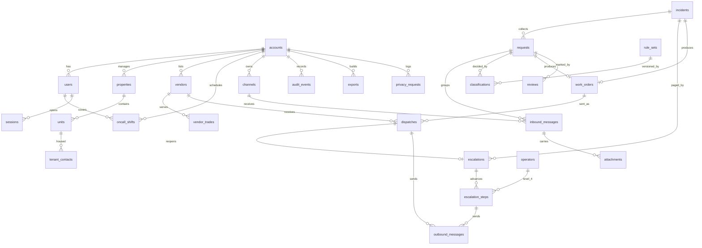

# Schema — FixTriage

PostgreSQL 16, Drizzle ORM (AD-02 in [TRD](TRD.md)). B1 (2026-11-11): the tables of sections 3.1-3.4 used by the safety spine exist as `code/packages/db/src/schema.ts` and migrations `0000_tables.sql` (generated) and `0001_rls_functions_views_grants.sql` (hand-written); `reviews`, `exports`, `privacy_requests` and `deletion_log` are not yet created. B1 changes are listed in section 3.5. "Account" = paying brokerage; "tenant" = renter. Rules cited (UR, EP, DU, FD) are in [PRD section 7](PRD.md#7-product-rules-canonical-other-files-cite-these-ids).

## 1. Entity-relationship diagram

## 2. Conventions

- Every table: `id uuid` primary key (default `gen_random_uuid()`), `created_at timestamptz not null default now()`. Mutable tables add `updated_at timestamptz not null` and `version int not null default 1` (optimistic concurrency).
- Every account-owned table: `account_id uuid not null references accounts(id)`, first column of every index, and row-level security (section 4). Omitted from the field lists below.
- Times are `timestamptz` in UTC; business-hours logic uses `accounts.timezone`. Phone numbers are E.164 `text` with a format check. Enumerations are `text` with `check` constraints so that ORM and migration stay identical (R-08).
- Sensitivity: **P** personal information of tenants, vendors or staff; **C** message content or photos (may include health or household details a tenant volunteers); **S** secret; **O** operational.

## 3. Dictionary

### 3.1 Account, people, places

| Table | Fields (type; null; default; constraint) | Sens. |
|---|---|---|
| `accounts` | `name text not null`; `licence_number text null`; `timezone text not null default 'America/Vancouver'`; `business_hours jsonb not null` (validated shape); `holidays date[] not null default '{}'`; `emergency_contact_name text null`, `emergency_contact_phone text null` (both required by the go-live check, EP-9); `gas_emergency_phone text not null default '+18006639911'`; `ack_timeout_seconds int not null default 300 check (between 180 and 600)`; `status text not null default 'onboarding' check in (onboarding, live, paused, closed)`; `plan text not null check in (pilot, starter, pro, business)`; `door_count int null`; `retention_months int not null default 24 check (between 12 and 36)` | O |
| `users` | `email citext not null`; `display_name text not null`; `mobile text null`; `role text not null check in (owner, manager)`; `is_reviewer boolean not null default false` (at most one true per account, partial unique index); `password_hash text not null`; `totp_secret_enc bytea null`; `totp_confirmed_at timestamptz null`; `totp_last_step bigint null`; `disabled_at timestamptz null`. Unique `(email)` globally | P, S |
| `operators` | **Not account-owned, no `account_id`.** `email citext not null unique`; `display_name text not null`; `mobile text not null`; `level4_rank smallint not null check in (1,2)` (1 primary, 2 backup), unique among active rows; `password_hash text not null`; `totp_secret_enc bytea null`; `totp_last_step bigint null`; `disabled_at timestamptz null`. Referenced from account tables by plain foreign key, never by composite key | P, S |
| `sessions` | `user_id uuid null → users`; `operator_id uuid null → operators`; `check (num_nonnulls(user_id, operator_id) = 1)`; `csrf_token_hash bytea not null`; `token_hash bytea not null unique`; `last_seen_at timestamptz not null`; `expires_at timestamptz not null`; `revoked_at timestamptz null` | S |
| `properties` | `label text not null`; `street_address text not null`; `city text not null`; `emergency_contact_phone text null` (overrides account); `gas_emergency_phone text null`. Unique `(account_id, street_address)` | O |
| `units` | `property_id uuid not null → properties`; `label text not null`. Unique `(account_id, property_id, label)` | O |
| `tenant_contacts` | `unit_id uuid not null → units`; `name text null`; `mobile text null`; `email citext null`; `sms_opted_out_at timestamptz null`; `deleted_at timestamptz null`; `check (mobile is not null or email is not null)` | P |
| `vendors` | `name text not null`; `mobile text null`; `email citext null`; `after_hours boolean not null default false`; `active boolean not null default true`. Unique `(account_id, mobile)` where mobile is not null | P |
| `vendor_trades` | `vendor_id uuid not null → vendors`; `trade text not null check in (plumbing, heating, electrical, locksmith, appliance, restoration, general, other)`; `rank int not null`. Unique `(account_id, trade, rank)`, unique `(vendor_id, trade)` | O |
| `oncall_shifts` | `user_id uuid not null → users`; `level smallint not null check in (1,2,3)`; `starts_at timestamptz not null`; `ends_at timestamptz not null check (ends_at > starts_at)`; `recurrence text null`; `last_test_page_at timestamptz null`; `last_test_page_ok boolean null`. Exclusion constraint: no overlapping range for the same `(account_id, level)` | P |
| `channels` | `kind text not null check in (sms, email)`; `address text not null` (number or mailbox); `provider text not null`; `status text not null default 'pending'`; `last_inbound_at timestamptz null` (last real message, informational). Unique `(address)` globally: one address resolves to exactly one account | O |

### 3.2 Intake and decision

| Table | Fields | Sens. |
|---|---|---|
| `inbound_messages` | `channel_id uuid not null → channels`; `provider text not null`; `provider_message_id text not null`; `from_address text not null`; `body text null`; `received_at timestamptz not null` (provider time); `stored_at timestamptz not null default now()`; `request_id uuid null → requests`; `tenant_contact_id uuid null → tenant_contacts`; `correlation_id uuid not null`; `raw_payload jsonb null` (cleared after 30 days); `safety_reply_id uuid null → outbound_messages` (null when one was sent to this sender in the previous 30 minutes or the sender is opted out). **Unique `(provider, provider_message_id)`** (DU-1) | P, C |
| `attachments` | `inbound_message_id uuid not null → inbound_messages`; `idx smallint not null`; `storage_key text null`; `content_type text null`; `bytes int null`; `status text not null default 'pending' check in (pending, stored, unavailable, rejected)`; `description_ai text null`. Unique `(inbound_message_id, idx)` | C |
| `requests` | `unit_id uuid null → units` (null = unknown sender, HI-6); `incident_id uuid null → incidents`; `incident_link_state text null check in (own, suggested, confirmed, rejected)` with `check ((incident_id is null) = (incident_link_state is null))`; `cannot_text boolean not null default false` (FD-7); `trade text null`; `tier text not null default 'uncertain' check in (life_safety, urgent, uncertain, routine)`; `tier_source text not null check in (pending, rule, model, uncertainty, human)` (`pending` = no decision yet, shown as `uncertain`, may move once to any tier; B1); `after_hours boolean not null`; `state text not null default 'open' check in (open, awaiting_tenant, awaiting_approval, dispatched, closed)`; `opened_at timestamptz not null`; `closed_at timestamptz null`. A new request defaults to `uncertain`, never `routine` | C |
| `rule_sets` | `version int not null unique`; `definition jsonb not null`; `activated_at timestamptz null`; `checksum text not null`. Global, read-only to accounts | O |
| `classifications` | `request_id uuid not null → requests`; `kind text not null check in (rule, model, human)`; `rule_set_version int null → rule_sets(version)`; `matched_rule text null`; `provider text null`; `model text null`; `prompt_version text null`; `proposed_tier text null`; `proposed_trade text null`; `proposed_unit_id uuid null`; `confidence numeric(4,3) null`; `missing_fields text[] null`; `status text not null check in (ok, failed, timeout, late)`; `actor_user_id uuid null → users`; `reason text null`; `check (kind <> 'human' or actor_user_id is not null)`. Append-only | C |
| `reviews` | `request_id uuid not null → requests`; `reviewer_user_id uuid not null → users`; `verdict text not null check in (accepted, corrected)`; `corrected_trade text null`; `corrected_tier text null`; `corrected_unit_id uuid null`; `was_urgent_missed boolean not null default false`; `check (verdict = 'accepted' or corrected_trade is not null or corrected_tier is not null or corrected_unit_id is not null)`. Unique `(request_id)`; a changed review is a new audit event | O |

### 3.3 Incident, escalation, dispatch

| Table | Fields | Sens. |
|---|---|---|
| `incidents` | `property_id uuid null → properties`; `hazard_class text not null`; `tier text not null`; `state text not null default 'open' check in (open, acknowledged, outcome_recorded, downgraded, closed)` (returns to `open` whenever an escalation is reopened, EP-11); `building_wide boolean not null default false`; `building_wide_set_by uuid null → users`; `check (not building_wide or building_wide_set_by is not null)`; `outcome text null check in (vendor_dispatched, handled_by_phone, attending, downgraded)`; `outcome_by uuid null → users`; `outcome_at timestamptz null`; `downgrade_reason text null`; `check (state <> 'downgraded' or downgrade_reason is not null)`. Report count is computed from `requests` (DU-3), not stored | C |
| `escalations` | `incident_id uuid not null → incidents`; `trigger text not null check in (new_incident, uncertain_timeout, no_outcome, dispatch_failed, new_unit_report)`; `dispatch_id uuid null → dispatches`, `check (trigger <> 'dispatch_failed' or dispatch_id is not null)`, unique `(dispatch_id)` where not null; `request_id uuid null → requests` (the report that reopened it); `state text not null default 'paging' check in (paging, acknowledged)`; `current_level smallint not null default 1`; `cycle int not null default 1`; `next_due_at timestamptz null`; `operator_engaged_by uuid null → operators`; `operator_engaged_at timestamptz null` (does not change `state`, EP-5); `acknowledged_by uuid null → users` (always a person of the account); `acknowledged_via text null check in (voice, link, app, operator_relay)`; `relayed_by_operator_id uuid null → operators`, `check ((acknowledged_via = 'operator_relay') = (relayed_by_operator_id is not null))`; `acknowledged_at timestamptz null`; `check (state <> 'acknowledged' or acknowledged_by is not null)`; `tenant_notice_sent_at timestamptz null`; `policy_version int not null`. **Unique `(incident_id)` where `state = 'paging'`**: one live escalation per incident, any number over time | O |
| `escalation_steps` | `escalation_id uuid not null → escalations`; `cycle int not null`; `level smallint not null check in (1,2,3,4)`; `attempt smallint not null`; `target_user_id uuid null → users` (Levels 1-3); `target_operator_id uuid null → operators` (Level 4); `check ((level = 4) = (target_operator_id is not null))`; `due_at timestamptz not null`; `started_at timestamptz null`; `result text null check in (acknowledged, operator_engaged, timeout, delivery_failed, superseded)`. **Unique `(escalation_id, cycle, level, attempt)`** | P |
| `outbound_messages` | `purpose text not null check in (safety_reply, notice, tenant_update, follow_up, page_sms, page_voice, dispatch, digest, test_page, probe)`; `to_address text not null`; `channel text not null check in (sms, voice, email)`; `template_id text null`; `template_version int null`; `body text not null`; `body_sha256 bytea not null`; `dedupe_key text not null`; `status text not null default 'pending' check in (pending, sending, sent, delivered, undelivered, failed, unknown)`; `status_rank smallint not null default 0`; `provider_message_id text null`; `attempts smallint not null default 0`; `escalation_step_id uuid null`; `dispatch_id uuid null`; `request_id uuid null`; `correlation_id uuid not null`; `approved_by uuid null → users`. **Unique `(account_id, dedupe_key)`**; `check (purpose <> 'dispatch' or approved_by is not null)` (FD-1) | P, C |
| `work_orders` | `request_id uuid null → requests`; `incident_id uuid null → incidents`; `unit_id uuid null → units`; `trade text not null`; `tier text not null`; `summary text not null`; `access_notes text null`; `state text not null default 'draft' check in (draft, approved, sent, confirmed, no_response, closed)`; `check (request_id is not null or incident_id is not null)`. Unique `(incident_id)` where not null (DU-5) | C |
| `dispatches` | `work_order_id uuid not null → work_orders`; `vendor_id uuid null → vendors`; `free_text_recipient text null`; `seq smallint not null`; `approved_by uuid not null → users`; `approved_at timestamptz not null`; `confirm_due_at timestamptz not null`; `result text null check in (confirmed, declined, timeout, undelivered, phoned)`; `result_at timestamptz null`. Unique `(work_order_id, seq)` | P |
| `capability_tokens` | `purpose text not null check in (ack, vendor)`; `token_hash bytea not null unique`; `escalation_step_id uuid null → escalation_steps` and `user_id uuid null → users` (both required for `ack`: the link acknowledges as the person that step paged, MH-06); `dispatch_id uuid null → dispatches` (required for `vendor`); `expires_at timestamptz not null`; `used_at timestamptz null` | S |

### 3.4 Operations

| Table | Fields | Sens. |
|---|---|---|
| `audit_events` | `actor_kind text not null check in (user, operator, system, tenant, vendor, provider)`; `actor_id uuid null`; `action text not null`; `object_type text not null`; `object_id uuid not null`; `before jsonb null`; `after jsonb null`; `reason text null`; `correlation_id uuid not null`. Insert-only (no update or delete grant). Holds IDs and enumerated values, not message text | O |
| `exports` | `requested_by uuid not null → users`; `params jsonb not null`; `state text not null default 'queued' check in (queued, building, ready, failed, expired)`; `storage_key text null`; `row_count int null`; `expires_at timestamptz null` | C |
| `privacy_requests` | `kind text not null check in (access, correction, deletion)`; `subject_ref text not null`; `received_on date not null`; `due_on date not null` (received + 30 days `[S: SRC-03, s.29]`); `outcome text null`; `closed_at timestamptz null` | P |
| `deletion_log` | `object_type text not null`; `object_id uuid not null`; `deleted_at timestamptz not null`; `reason text not null`. Contains no personal data; replayed after a restore | O |
| `probe_runs` | Not account-owned. `kind text not null check in (sms_round_trip, email_inbound)`; `sent_at timestamptz not null`; `received_at timestamptz null`; `ok boolean null`. Platform probe numbers only; no account channel is used (MH-16c) | O |

### 3.5 Changes made in B1 (2026-11-11)

Implementation needed the following; each is in the ORM schema and the migrations, and covered by the ORM-diff check (IT-14).

| Table | Change | Why |
|---|---|---|
| `requests` | `tier_source` value `pending`; check `tier_source <> 'pending' or tier = 'uncertain'` | A request without a rule hit waits for the classifier without being `routine` (UR-3) and without the model "lowering" a decided tier; the UR-6 trigger allows only the first move out of `pending` |
| `inbound_messages` | `media_count smallint`, `keyword text check in (stop, start, help)` | Photo-only detection (UR-3); the latest STOP/START from an address decides opt-out, also for unknown senders (FD-7) |
| `outbound_messages` | `next_attempt_at timestamptz null`; index `(account_id, to_address, purpose, created_at)` | Retry spacing (TRD 6.3) and the 30-minute safety-reply window (MH-02) |
| `classifications` | `inbound_message_id uuid null`; unique `(inbound_message_id, model) where kind = 'model'` | Idempotency key of the classify job `(inbound_message_id, model_version)` (TRD 6.3) |
| `dispatches` | `emergency boolean not null` | FD-3 vs FD-4 decided once at approval |
| `escalations` | `started_at`, `companions jsonb` (people paged with Level 1 on reopen: previous acknowledger, approver), `outcome_reminder_sent_at` | EP-11, FD-3, EP-7 |
| `escalation_steps` | `target_role text check in (oncall, previous_acknowledger, approver, operator_primary, operator_backup)` in the unique key; result value `no_target`; Level-4 check allows a missing operator row | Several people are paged at the same (cycle, level, attempt) under EP-5 and EP-11; a level with nobody to page is recorded and skipped at once |
| `jobs` (new, account-owned, RLS) | `kind`, `payload`, `dedupe_key` unique per account, `run_at`, `state`, `attempts`, `correlation_id` | Replaces pg-boss (TRD AD-02 note) |
| `idempotency_keys` (new, account-owned, RLS) | `(account_id, key, route)` unique; stored status and body | `Idempotency-Key` on mutations (TRD 5.1) |
| `pending_status_events` (new, global, no personal data) | provider, provider message ID, status, received time, attempts | A status for an ID not yet known is stored and retried (TRD 5.1, IT-09) |
| `sessions` | Global (no `account_id`, no RLS); the application role has no grant; read only through `resolve_session` | Sessions also belong to operators, who have no account |
| Resolver functions and poll views | Owned by the migration (database owner) role in B1; the separate `resolver` role is deferred to deployment | Local build machine; the column lists are checked by IT-10 |

Fix round 1 (2026-11-11, review fixtriage-b1-round1.md):

| Object | Change | Finding |
|---|---|---|
| `unrouted_inbound` (new, global) | provider, kind, provider message ID (unique per provider), destination address, received time, `cleared_at`, `cleared_by_operator_id`. **Metadata only**: no sender and no text, so no tenant data sits outside an account; the operator retrieves the message from the provider by its ID. An uncleared row fails `/readyz`, so the external monitor alerts both operators. Postmark is answered 503 (it retries); Twilio 200 (it does not retry inbound). Whether to keep message text for the operator stays an owner decision | B1-004 (resolves the earlier open gap) |
| `channels` | Unique index on `lower(address)` (`channels_address_lower_uq`) replaces `channels_address_uq`; `resolve_channel` compares `lower(btrim(...))`. Built inside the migration transaction, not concurrently: the table is empty before go-live | B1-004 |
| view `due_jobs` | Adds `kind` so model jobs run in their own runner | B1-002 |
| view `due_undecided` (new) | `id`, `account_id`, `due_at`: requests with no incident that are `pending`, `uncertain` or cannot-text and have no human classification; due 30 s after receipt if pending, at once after hours, at 15 min in business hours | B1-001 |
| view `job_health` (new) | `dead_jobs` count only | B1-001 |
| trigger `accounts_validate` | Rejects an unknown time zone or malformed business hours | B1-009 |
| `rule_sets` | Version 2 seeded (v1 kept, unchanged checksum); new decisions store `rule_set_version = 2` | B1-003 |

## 4. Permissions, account boundary, uniqueness

| Object | `owner` | `manager` | `operator` | `web` service role | `worker` service role |
|---|---|---|---|---|---|
| Requests, incidents, work orders | read, write | read, write | read with reason, audited; write "operator engaged", call log and relayed acknowledgement only | via `withAccount` | via `withAccount` |
| Review marks counted in SM-03 | only if `is_reviewer` | only if `is_reviewer` | no | — | no |
| Downgrade tier, approve dispatch, merge | yes | yes | no | — | no (never system-initiated) |
| On-call, vendors, account, users, privacy | read, write | read | read | via `withAccount` | read |
| `rule_sets` | read | read | write through release only | read | read |
| `audit_events` | read | read own actions | read | insert | insert |

- Row-level security: `using (account_id = current_setting('app.account_id')::uuid)` with `force row level security` on every account-owned table; the application roles are not table owners and have no `bypassrls`. With `app.account_id` unset, queries return no rows.
- Operators are rows in `operators`, outside every account. An operator enters an account through an explicit, audited "support session" that sets `app.account_id` for that account only.
- **Access outside `withAccount`** (the complete list; each is a `security definer` function or a view owned by role `resolver`, granted to the service roles, returning only these columns):

| Name | Used by | Columns returned |
|---|---|---|
| `resolve_channel(address)` | Inbound webhooks | `account_id`, `channel_id` |
| `resolve_session(token_hash)` | Every authenticated request | `user_id`, `operator_id`, `account_id`, `role`, `expires_at`, `csrf_token_hash` |
| `resolve_login(email)` | Sign-in, reset | `user_id` or `operator_id`, `account_id`, `password_hash`, TOTP fields, `disabled_at` |
| `resolve_capability(token_hash)` | `/a/:token`, `/v/:token` | `account_id`, `purpose`, `escalation_step_id`, `user_id`, `dispatch_id`, `expires_at`, `used_at` |
| `resolve_outbound(provider_message_id)` | Delivery-status webhook | `account_id`, `outbound_message_id` |
| view `due_escalations` | `escalation.tick` | `id`, `account_id`, `next_due_at` |
| view `pending_outbox` | `outbox.send` | `id`, `account_id`, `created_at`, `next_attempt_at` (B1: retry time) |
| view `due_dispatches` | `dispatch.watch` | `id`, `account_id`, `confirm_due_at` |
| view `sweep_accounts` | `digest.daily`, `retention.sweep` | `id` of accounts, `status` |
| view `due_jobs` (B1) | job runners (safety loop: `intake.process`, `triage.timeout`; model loop: `classify`) | `id`, `account_id`, `run_at`, `kind` |
| view `due_undecided` (B1-001) | decision sweep in the safety loop | `id`, `account_id`, `due_at` |
| view `job_health` (B1-001) | `/readyz` | `dead_jobs` (a count) |

  None returns message text, names, phone numbers or addresses. Tables `operators`, `rule_sets`, `probe_runs` are global and hold no tenant data. IT-10 calls every function and view with crafted inputs and checks the column list.
- Cross-account denial: a foreign-key lookup of another account's ID returns "not found"; composite foreign keys `(account_id, id)` on child tables prevent a row in one account from referencing a parent in another. References to `operators` (`escalation_steps.target_operator_id`, `escalations.operator_engaged_by`, `relayed_by_operator_id`, `sessions.operator_id`) are plain foreign keys because operators belong to no account.
- Uniqueness scope: provider message IDs and channel addresses are global; everything else is unique within `account_id`.

## 5. Indexes and their queries

| Index | Query served |
|---|---|
| `inbound_messages (provider, provider_message_id)` unique | Webhook de-duplication (DU-1) |
| `channels (lower(address))` unique (B1-004) | `resolve_channel`, case-insensitive |
| `unrouted_inbound (provider, provider_message_id)` unique (B1-004) | One record per unrouted message across provider retries |
| `inbound_messages (account_id, from_address, received_at desc)` | Same-sender threading within 30 minutes (DU-2) |
| `requests (account_id, state, tier, opened_at desc)` | S-03 inbox sections |
| `incidents (account_id, property_id, hazard_class, created_at desc) where state in ('open','acknowledged')` | Duplicate suggestion within 6 hours (DU-3) |
| `requests (account_id, incident_id, incident_link_state)` | Report count and units of an incident; "suggested" list on S-05 |
| `escalations (incident_id) where state = 'paging'` unique | One live escalation per incident; reopen check (EP-11) |
| `escalations (next_due_at) where next_due_at is not null` | View `due_escalations` for `escalation.tick`; B1 keeps `next_due_at` on an acknowledged escalation for the EP-7 reminder and EP-11a reopen |
| `escalation_steps (escalation_id, cycle, level, attempt, target_role)` unique | Idempotent step creation (B1 adds `target_role`) |
| `outbound_messages (status, created_at) where status in ('pending','unknown')` | Outbox poll |
| `outbound_messages (provider_message_id)` | Delivery-status webhook lookup |
| `dispatches (confirm_due_at) where result is null` | `dispatch.watch` |
| `oncall_shifts (account_id, level, starts_at, ends_at)` | "Who is on call now" and the 14-day coverage check (EP-9) |
| `reviews (account_id, created_at)`; `requests (account_id, after_hours, opened_at)` | SM-01, SM-03 report; S-12 "last night" |
| `audit_events (account_id, object_type, object_id, created_at)` | Timeline and audit trail |
| `sessions (token_hash)`; `capability_tokens (token_hash)` | Request authentication |

New indexes on existing tables are created with `create index concurrently` in their own non-transactional migration (R-11).

## 6. Provenance, versions, transactions, duplicates

- Provenance: `inbound_messages` keeps provider, provider ID, provider time and our time; `classifications` keeps who or what decided, with rule-set version, matched rule, provider, model and prompt version; `outbound_messages` keeps template ID and version and the hash of the exact body; `audit_events` ties them together by `correlation_id`.
- Transaction boundaries: (T1) webhook: insert inbound message + outbox safety reply + classify job, one transaction; a unique violation means "already processed" and returns 200. (T2) rule evaluation: insert rule classification + set request tier + create incident and escalation with first step, one transaction. (T3) tick: lock escalation row `for update skip locked`, insert next steps and their outbox rows, update `next_due_at`. (T4) acknowledge: compare `version`, set escalation `acknowledged` with the account person (from the session, the keypress step's target, or the capability token's `user_id`), set incident state, mark open steps `superseded`. (T6) reopen: insert a new `escalations` row with its trigger and first steps and set the incident back to `open`; the partial unique index makes a second concurrent reopen a no-op. (T5) approve dispatch: compare body hash, insert dispatch + outbox row, set work order `sent`.
- Tier can only be raised by T2 and by late model results; a `check` trigger rejects a lower tier unless the same transaction inserts a `human` classification with a reason (UR-6).
- Duplicates: DU-1 by unique constraint; DU-2 by threading query inside T1's follow-up job under an advisory lock per `(account_id, from_address)`; DU-3 sets `incident_id` with `incident_link_state = 'suggested'`; a human sets `confirmed` or `rejected` (rejection creates a new incident and escalation for that request); unmerge returns `confirmed` to `rejected`. Report count = requests linked as `own`, `suggested` or `confirmed`. DU-4c is evaluated in the same transaction that links the request: different `unit_id`, higher tier or `life_safety` on an acknowledged incident that is not `building_wide` runs T6. No row is deleted by a merge.
- Audit history: every state change in T2-T5 writes an `audit_events` row in the same transaction.

## 7. Sensitivity and retention (all periods proposed)

| Data | Retention | Basis |
|---|---|---|
| Requests, messages, classifications, work orders, dispatches, reviews | `accounts.retention_months`, default 24, minimum 12, from request close | At least one year after a decision that directly affects the individual `[S: SRC-03, s.35(1)]`, assumed to apply `[A]`; destroy when no longer necessary `[S: SRC-03, s.35(2)]` |
| Photos and other attachments | Same as their request | Same |
| `inbound_messages.raw_payload` | 30 days | Debugging only |
| Exports, objects under `tmp/` | 7 days; storage lifecycle rule plus sweep job (R-14) | — |
| Tenant contacts | Until removed by the account or account closure + 30 days | Account's instruction |
| Audit events | 36 months | Dispute evidence; no message text |
| Application logs | 90 days; no personal data | — |
| Sessions, used tokens | 30 days after expiry | — |

## 8. Export, deletion, backup expiry, restore

- Export: per account (all tables as CSV plus attachments, by `owner` request through the operator) and per tenant contact (messages, requests, work orders, dispatch recipients — the names of organizations the information was disclosed to are part of an access response `[S: SRC-03, s.23(1)(c)]`).
- Deletion: per tenant contact (messages and attachments redacted, request rows kept with `unit_id` only) or per account. Each deletion writes `deletion_log`. Records younger than 12 months that fall under s.35(1) are flagged and held until 12 months unless the `owner` confirms otherwise in writing.
- Backup expiry: deleted data persists in database snapshots and object versions for up to 35 days and is then gone; this is stated to the user on the deletion review step.
- Restore: after any restore, `deletion_log` entries newer than the restored point are replayed before the application is reopened; open escalations are re-evaluated (any incident `open` with `next_due_at` in the past is paged immediately) and inbound messages received during the gap are re-fetched from the providers where available. Restore runs with channels paused and the S-15 banner on.

## 9. Migrations

- Ordering: one linear sequence of SQL files generated from the Drizzle schema (B1: drizzle-kit's `0000_`, `0001_` index prefixes with the order in `meta/_journal.json`, checked by `checkJournalOrder`; hand-written objects in a `--custom` migration); CI fails if two branches add migrations with the same parent (R-10) or if the generated diff between ORM schema and a freshly migrated database is not empty (R-08).
- Order of creation: `accounts` → `users`, `sessions` → places and people → `channels` → `operators` → `rule_sets` → `incidents` → `requests` → intake tables → `work_orders`, `dispatches` → `escalations`, steps → `outbound_messages` → operations tables → RLS policies → resolver functions and views → grants.
- Expand, migrate, contract: additive change first; code that reads both; backfill; code that reads new; removal in a later release.
- Backfills: separate resumable jobs, batches of 1,000 rows keyed by `id`, progress stored in a `backfill_progress` row, safe to re-run (R-09).
- Locks: `lock_timeout` 3 s and `statement_timeout` 30 s on every migration; no table rewrite on `inbound_messages`, `outbound_messages`, `audit_events`; indexes concurrently; constraints added `not valid` then validated.
- Partial execution: each migration file is one transaction except concurrent index files; a failed concurrent index is dropped and recreated by the next run; the migration task is idempotent and records applied files in `schema_migrations`.
